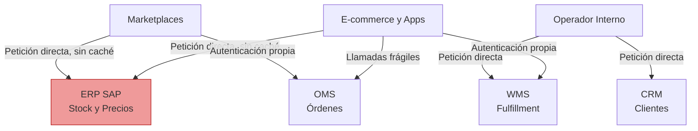
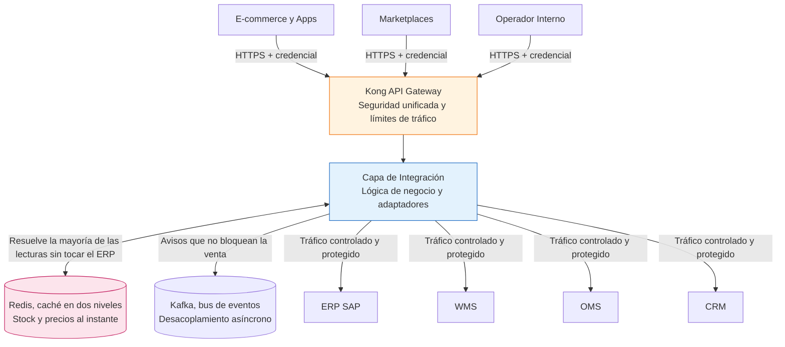
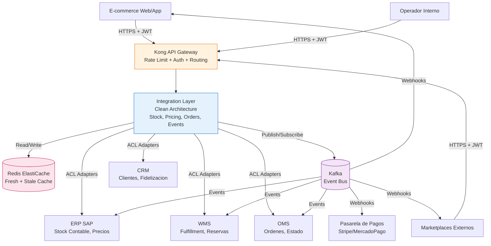
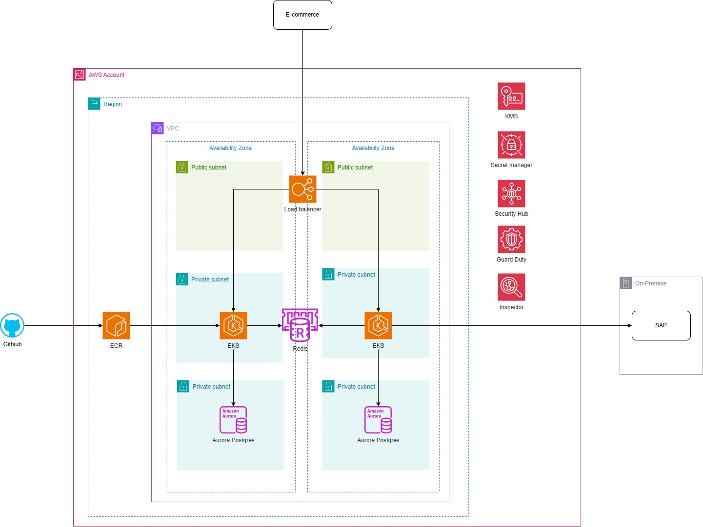
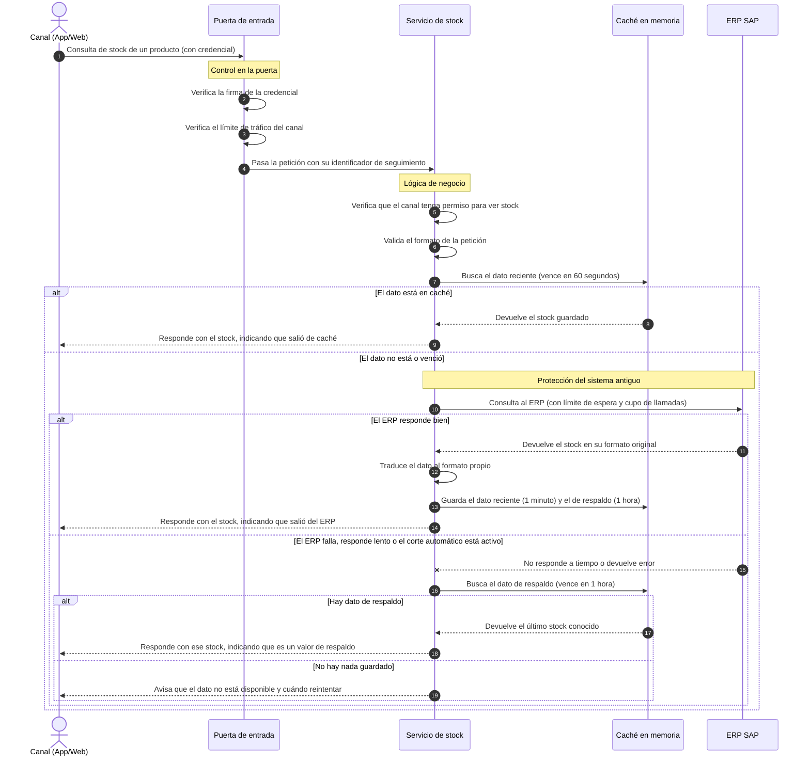
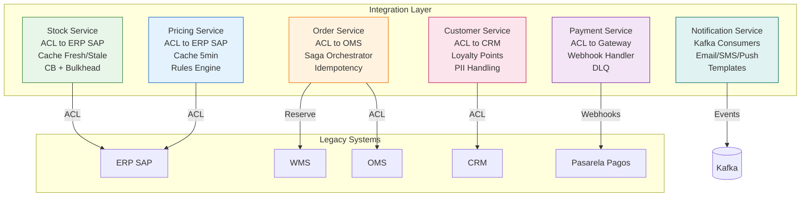
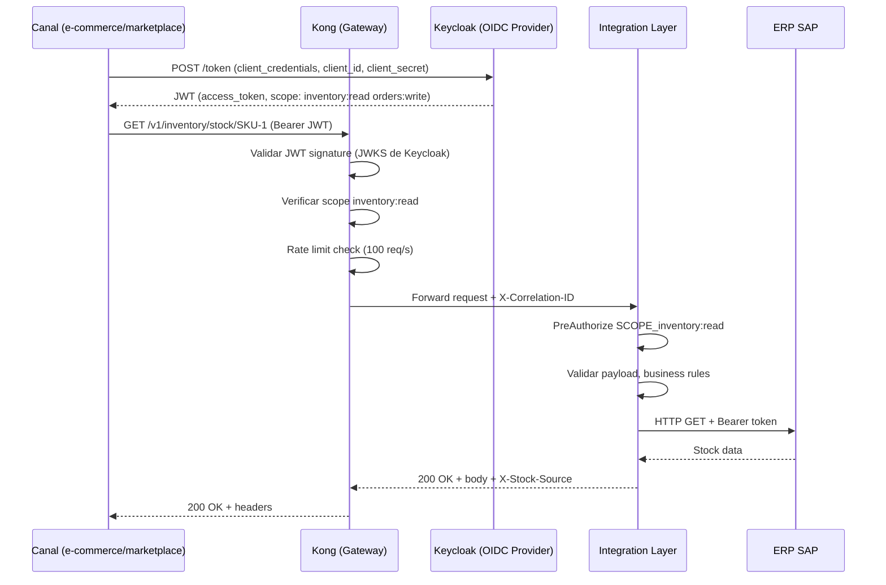
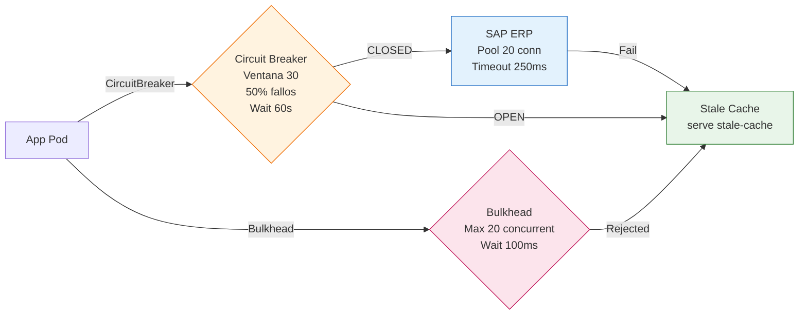

# Capa de Interoperabilidad AndesRetail — Diseño Arquitectónico

> **Documento de entrega — Prueba Técnica Arquitecto/a Senior de Software & Soluciones**
> **Empresa**: AndesRetail (retail multi-canal, ERP SAP, WMS, OMS, CRM)
> **Autor**: Edwin Ramirez
> **Fecha**: Octubre 2026
> **Versión**: 1.0

---

## 1. Resumen Ejecutivo

### El problema

Hoy AndesRetail conecta sus sistemas con integraciones hechas a medida, una por cada par de sistemas. El ERP SAP habla con el e-commerce por un camino, con los marketplaces por otro, y el WMS y el OMS tienen los suyos. Ese esquema funciona mientras nada cambie, pero se rompe en cuanto hay presión.

En una promo fuerte, los canales consultan stock y precios miles de veces por minuto y esas consultas llegan directo al ERP, que no está dimensionado para ese volumen. Cuando el ERP se satura, se cae, y con él se cae la venta. A esto se suman otros problemas que se notan más con el tiempo: no hay una forma de seguir un pedido de punta a punta cuando algo falla, cada integración resolvió la autenticación a su manera, y un cambio en un sistema obliga a tocar varios otros.

### La solución

En lugar de seguir cosiendo sistemas entre sí, se construye una capa intermedia que todos usan. Los canales dejan de hablar con el ERP: hablan con esta capa, que se encarga de resolver todo lo demás.

1. **Una capa de interoperabilidad** que vive en AWS y expone APIs ordenadas hacia afuera. Es el único punto de entrada, así que ahí se controla quién entra y cuánto puede pedir.
2. **Un adaptador por cada sistema legacy** (ERP, WMS, OMS, CRM), que traduce los datos de cada uno a un formato común y los protege con mecanismos de corte: si el ERP no responde, la capa deja de insistirle en lugar de arrastrar la caída hacia el resto.
3. **Caché en dos niveles.** El stock y los precios se guardan un minuto en memoria rápida; si el ERP se cae, se sigue sirviendo el último valor conocido durante una hora. Es la diferencia entre mostrar stock un poco desactualizado o mostrar un error al cliente.
4. **Comunicación asíncrona** para lo que no necesita respuesta inmediata (confirmar un pago, notificar un despacho), de modo que el flujo de compra no se bloquee si un sistema de atrás está lento.
5. **Un solo esquema de autenticación** para todos los canales, con permisos distintos según quién sea y límites de tráfico por cliente.
6. **Visibilidad completa** del recorrido de cada request, para poder responder "¿qué pasó?" sin adivinar.
7. **Código organizado por responsabilidad**, con reglas que la propia herramienta verifica, para que cambiar una pieza no obligue a reescribir las demás.

### Qué gana el negocio

| Beneficio | Qué significa en la práctica |
|---|---|
| **Menos incidentes en promos** | Antes una caída del ERP tumbaba la venta completa. Con esta capa, el canal sigue mostrando stock (aunque sea de hace un rato) y solo se bloquea el dato que de verdad no se puede servir. Se pasa de "todo caído" a "degradado, pero vendiendo". |
| **Respuesta rápida** | El 95% de las consultas debe resolverse en menos de 300 milisegundos. La mayoría sale de caché y ni siquiera toca el ERP; cuando lo toca, hay un límite de espera estricto para que una lentitud del ERP no se convierta en una lentitud del cliente. |
| **Disponibilidad del 99.9%** | El sistema está preparado para perder una zona de AWS sin dejar de atender, se escala solo cuando sube la carga y tiene respuesta preparada para cada tipo de fallo. |
| **Integrar canales nuevos deja de ser un proyecto** | Un canal nuevo se conecta a contratos que ya existen, en días en vez de semanas. Antes cada integración se diseñaba desde cero. |
| **Poder auditar y responder** | Cada operación queda registrada con un identificador que permite reconstruir el recorrido completo. Necesario para auditoría y para resolver reclamos. |
| **Costo bajo control** | Se usa hardware con mejor relación precio/rendimiento y servicios que cobran por uso real, no por capacidad reservada. |

---

## 2. Preguntas, Supuestos y Riesgos

### Lo que necesitamos preguntarle al cliente

Estas preguntas existen porque las respuestas cambian decisiones concretas del diseño. No son formalidades: cada una mueve algo.

| # | Pregunta | Qué decisión cambia según la respuesta |
|---|---|---|
| 1 | ¿El ERP SAP expone una API moderna (OData/REST) y cuánto puede tardar en responder? | Si responde rápido, se puede esperar su respuesta en vivo. Si no, hay que apoyarse más en caché. De aquí sale el límite de 250ms que usamos. |
| 2 | ¿El WMS permite reservar stock por API o solo recibe archivos por lotes? | Con API se puede reservar en el momento; solo por lotes obliga a un flujo de conciliación distinto. |
| 3 | ¿La pasarela de pagos avisa por webhook cuando un pago se aprueba? | Si avisa, se libera al cliente de esperar. Si no, hay que consultar el estado periódicamente. |
| 4 | ¿Quién es la fuente de verdad del stock: el ERP (contable) o el WMS (físico)? | Define cuál dato mostramos y cómo se reconcilian cuando no coinciden. |
| 5 | ¿Hay marcas o regiones con datos separados? ¿Cómo se identifica cada una? | Si existen, el diseño necesita separar permisos y datos desde el primer día. |
| 6 | ¿Qué disponibilidad garantiza cada sistema legacy? | Define cuándo dejar de insistir (cortar) y por cuánto tiempo. |
| 7 | ¿Ya existe una plataforma de mensajería en la empresa? | Si hay una, se usa esa en lugar de instalar otra. |
| 8 | ¿Qué volumen se espera en un pico? | Dimensiona el escalado automático y los límites de tráfico. |
| 9 | ¿Hay exigencias regulatorias aplicables (PCI-DSS, protección de datos)? | Define cuánto aislamiento y cuánto cuidado con datos personales. |
| 10 | ¿Qué sistemas siguen en la lista para integrar? | Define cuán fácil debe ser enchufar un sistema nuevo. |

### Supuestos de trabajo

Todo diseño se para sobre algo. Estos son los supuestos que asumimos, y qué pasa si alguno no se cumple.

| # | Supuesto | Qué sostenemos con él |
|---|---|---|
| 1 | El ERP puede responder stock y precios en menos de 500ms | Es lo que permite fijar un límite de espera de 250ms y confiar en la caché para el resto. |
| 2 | El WMS permite reservar stock por API | Habilita vender y reservar en el mismo instante. |
| 3 | La pasarela de pagos reintenta sus avisos sola | Nos permite no estar preguntándole el estado todo el tiempo. |
| 4 | El ERP manda en el stock contable y el WMS en el físico | Explica por qué aceptamos pequeñas diferencias temporales entre ambos. |
| 5 | Pico de ~1000 consultas por segundo y ~100 órdenes por minuto | Es la base del dimensionamiento; si el pico real es mucho mayor, hay que recalcular. |
| 6 | Los canales se separan por tipo (e-commerce, marketplace, operador) con permisos distintos | Define el modelo de permisos inicial. |
| 7 | AWS es el proveedor de nube | Es lo que la prueba sugiere como objetivo. |
| 8 | El equipo ya trabaja con Spring Boot/Kotlin y con AWS | Evita suponer una curva de aprendizaje grande. |
| 9 | Se puede disponer de Kafka | Habilita el flujo asíncrono para pagos y notificaciones. |
| 10 | La exigencia PCI-DSS es de nivel 2/3, no de nivel 1 | Con esto basta aislar el entorno de datos sensibles; si fuese nivel 1 habría que añadir tokenización. |

### Riesgos y cómo los cubrimos

| # | Riesgo | Impacto | Cómo lo mitigamos |
|---|---|---|---|
| 1 | El ERP responde más lento de lo esperado y el sistema deja de insistirle constantemente | Alto | Se sirve el último valor conocido durante una hora, se avisa de la degradación en vez de fallar de golpe, y se mide la lentitud del ERP para tener evidencia. |
| 2 | El WMS no soporta reservas atómicas y dos ventas toman el mismo stock | Alto | Cada operación lleva una clave única que evita duplicados, y si algo falla a mitad del proceso se revierte lo hecho. |
| 3 | El servicio de autenticación queda como único punto de falla | Alto | Corre con dos instancias y su base de datos es redundante entre zonas. |
| 4 | El costo de AWS supera lo presupuestado | Medio | Se usan instancias más eficientes, servicios que cobran por uso y capacidad comprada a largo plazo. |
| 5 | El equipo no conoce alguna de las tecnologías elegidas | Medio | Se documentan los procedimientos y se acompaña con capacitación; para eso existen los runbooks. |
| 6 | Se filtran datos personales en los logs | Alto | Los logs guardan identificadores, no datos personales, y hay controles automáticos que revisan que así sea. |
| 7 | La configuración se desvía entre lo declarado y lo que está desplegado | Medio | Se compara periódicamente lo declarado con lo real y se detecta la diferencia a tiempo. |
| 8 | El límite de tráfico bloquea clientes legítimos | Medio | Los límites son por cliente, no globales, y se vigila cuántos rechazos hay. |


---

## 3. Arquitectura de Alto Nivel

### 3.1 Cómo está hoy: integraciones punto a punto

Antes de proponer nada, conviene ver el punto de partida. Hoy cada canal se conecta
directamente con cada sistema interno, y cada conexión se construyó por separado.
El resultado es una telaraña donde nadie tiene una visión completa de lo que pasa.



Cada línea de este diagrama es un problema en potencia. Todas las consultas de
stock y precio llegan directo al ERP sin nada que las contenga, así que un pico de
tráfico lo satura. Cada canal resolvió la autenticación a su manera, de modo que
hay tantos esquemas de seguridad como integraciones. Y como nada pasa por un punto
común, no hay forma de saber cuántas consultas se hicieron, cuánto tardaron ni
dónde falló una en particular. Cuando el ERP se cae, se cae todo lo que depende de
él, que es casi todo.

### 3.2 Cómo queda con la capa nueva

El cambio de fondo es simple de enunciar: en lugar de conectar cada canal con cada
sistema, todos pasan por una capa intermedia. Esa capa es la que concentra el
control de acceso, la caché y la protección de los sistemas antiguos.



La diferencia se nota en varios frentes a la vez. Los canales ya no llegan al ERP:
se autentican una sola vez y con un solo estilo, y la caché resuelve la mayor parte
de las consultas de lectura antes de que salgan del sistema. Cuando sí hay que
consultar a un sistema interno, la llamada sale con un límite de tiempo, con un
cupo máximo de llamadas simultáneas y con un corte automático si ese sistema viene
fallando. Y todo lo que no necesita respuesta inmediata se publica como aviso, de
modo que un sistema lento no detenga la compra.

Lo que se gana con este cambio no es solo velocidad. Los sistemas internos quedan
protegidos por diseño, la integración de un canal nuevo deja de empezar de cero, y
por primera vez hay un punto único donde medir qué está pasando.

### 3.3 El sistema completo, con todos sus actores

El diagrama anterior era el contraste: qué cambia al pasar de conexiones directas a
la capa intermedia. Este es el sistema en su forma final, con todos los actores que
aparecen más adelante en el documento, incluidos la pasarela de pagos y los avisos
que vuelven hacia los canales.



Lo importante de este dibujo es que **ningún canal habla directamente con el ERP**. Todo pasa por la capa intermedia, que es donde se decide qué se responde, de dónde se saca el dato y qué se hace si el sistema de atrás no contesta.

### 3.4 Las piezas y qué hace cada una

| Pieza | Para qué está | Con qué se construyó | Cómo crece |
|---|---|---|---|
| **Kong (puerta de entrada)** | Es lo primero que toca cada petición. Ahí se revisa quién es el cliente, si tiene permiso y si no está pidiendo más de lo que le corresponde. También reparte el tráfico hacia adentro. | Kong sobre Kubernetes | Se agregan instancias cuando sube la carga |
| **Capa de integración** | Es el cerebro. Recibe la petición ya validada, decide de dónde obtener el dato, traduce lo que devuelven los sistemas antiguos y arma la respuesta. | Kotlin + Spring Boot | Entre 2 y 10 instancias según demanda |
| **Redis** | Guarda en memoria los datos que se consultan todo el tiempo (stock y precios), de modo que la mayoría de las consultas no llegue nunca al ERP. | Redis con redundancia entre zonas | Se agranda la instancia o se reparte en clúster |
| **Kafka (bus de eventos)** | Para lo que no necesita respuesta inmediata: avisar que el stock cambió, que una orden se confirmó, que un pago se aprobó. En vez de que un sistema llame al otro, publica un aviso y quien lo necesite lo toma. | Kafka sobre Kubernetes | Se agregan particiones y consumidores |
| **Keycloak** | Único responsable de decir quién es quién. Entrega credenciales y define qué puede hacer cada canal. | Keycloak 24 con base de datos dedicada | Dos instancias activas |
| **Clúster de cómputo** | Es la plataforma donde corre todo lo anterior. Reparte el trabajo entre servidores y agrega capacidad cuando hace falta. | Kubernetes sobre hardware ARM | Escala solo según uso |
| **Base de datos Aurora** | Guarda usuarios, credenciales y metadatos de órdenes. No es la base del negocio: no almacena el stock. | PostgreSQL gestionado con escalado automático | Sube y baja según lo que se use |

### 3.5 Decisiones clave y qué costo tienen

#### Cuándo respondemos en el momento y cuándo en segundo plano

Esta es la decisión que más cambia el comportamiento del sistema. La regla es simple: si el cliente está esperando en pantalla, respondemos en el momento; si puede enterarse después, lo hacemos en segundo plano.

| Situación | Cómo se resuelve | Por qué |
|---|---|---|
| **Consultar stock o precio** | En el momento | El usuario está mirando la pantalla. No existe "te aviso luego" cuando alguien espera ver si hay producto. Se resuelve desde caché casi siempre, y contra el ERP solo cuando el dato está vencido. |
| **Crear una orden** | Mixto: validamos en el momento, confirmamos después | El cliente necesita saber ya si su compra quedó registrada y si había stock. Pero el cobro y la confirmación pueden tomarse su tiempo sin que el usuario espere en pantalla. |
| **Consultar estado de una orden** | En el momento, con caché corta | Es una consulta que no cambia nada, así que se puede responder rápido y repetir sin efectos secundarios. |
| **Avisos entre sistemas y webhooks** | En segundo plano | Son avisos: no hay nadie esperando la respuesta. Si un sistema está caído, el aviso se reintenta y no se pierde. |
| **Correos y mensajes al cliente** | En segundo plano | Nadie está mirando esa pantalla. Que un correo salga dos minutos más tarde no afecta la venta. |

#### Qué hace la puerta de entrada y qué no

Hay una discusión típica en estos sistemas: cuánto trabajo concentrar en el gateway. La regla que seguimos es no poner reglas de negocio ahí.

| Tarea | Dónde se hace | Por qué |
|---|---|---|
| **Verificar la credencial** | En la puerta de entrada | Se hace una sola vez para todas las peticiones y evita repetir el mismo código en cada servicio. |
| **Verificar permisos** | Mayormente en el servicio | El gateway descarta credenciales inválidas, pero decidir si un canal puede ver un dato concreto requiere conocer el dominio. |
| **Limitar el tráfico** | En la puerta de entrada | Es mejor frenar antes de que la petición consuma recursos. Protege a todos los servicios por igual. |
| **Repartir tráfico** | En la puerta de entrada | Permite cambiar versiones sin que los servicios se enteren. |
| **Terminar el cifrado** | En la puerta de entrada | Descifrar en un solo punto ahorra trabajo a las instancias internas. |
| **Transformar datos** | En los servicios, salvo excepciones | Meter lógica de negocio en el gateway lo vuelve un lugar difícil de mantener y de probar. |
| **Registrar para auditoría** | En ambos | El gateway deja constancia de lo que llegó y los servicios de lo que se hizo con eso. |

#### Dónde se valida y se transforma cada cosa

| Capa | Qué revisa o adapta |
|---|---|
| **Puerta de entrada** | Que la credencial sea válida y no esté vencida, que tenga el permiso básico, que el cliente no exceda su límite y que la conexión esté cifrada. |
| **Capa de integración** | Que el contenido de la petición tenga lo necesario y con el formato correcto, que se cumplan las reglas del negocio, y que la operación no se repita si es un reintento. |
| **Adaptadores** | Traducir lo que devuelven los sistemas antiguos: valores imposibles, formatos de fecha distintos, codificaciones raras. |
| **Dominio** | Las reglas que no se negocian: el stock no puede ser negativo, lo reservado no puede superar lo disponible. |

#### Cómo versionamos las APIs

Un canal no puede despertar un día y descubrir que el campo que usaba ya no existe.

| Estrategia | Cómo se aplica |
|---|---|
| **Versionado en la URL** | La versión va en la dirección (`/v1/...`), así conviven dos versiones sin pisarse. |
| **Cambios compatibles** | Se agregan campos, nunca se quitan ni se renombran los que ya existen. |
| **Aviso de desuso** | Antes de retirar algo se avisa en la respuesta con la fecha en que dejará de funcionar. |
| **Cambios que rompen** | Obligan a una versión nueva, y la anterior sigue viva al menos seis meses. |
| **Contrato primero** | La documentación de la API se genera del código y se valida automáticamente; no puede quedar desactualizada. |

### 3.6 Infraestructura propuesta en AWS

El despliegue se propone sobre la región `us-east-1` con dos zonas de
disponibilidad, para que la caída de una no detenga el servicio. La idea central
del diseño es separar por niveles de exposición: lo que recibe tráfico de Internet
vive en un segmento público; lo que ejecuta la aplicación vive en un segmento
privado que puede salir hacia afuera pero no ser alcanzado desde afuera; y los
datos viven en un tercer segmento sin salida a Internet, al que solo se llega
desde la aplicación. Si alguien compromete una instancia de la capa de aplicación,
no tiene camino directo hacia las bases de datos.

Cada bloque del diagrama tiene su contraparte en archivos del repositorio
(`infra/network_stack.py`, `infra/security_stack.py`, `infra/data_stack.py`,
`infra/compute_stack.py`), y la fuente editable está en
`docs/diagrams/infraestructura-aws.drawio`.



| Qué existe | Dónde está definido | Estado |
|---|---|---|
| Red aislada por niveles, con segmentos público, privado e interno en cada zona, salida controlada a Internet y registro de todo el tráfico de red | `infra/network_stack.py` | Definido en código |
| Cifrado de datos con clave rotada cada año y almacén central de credenciales | `infra/security_stack.py` | Definido en código |
| Caché en memoria con redundancia entre zonas y cifrado, y base de datos con escalado automático, ambos en el segmento interno | `infra/data_stack.py` | Definido en código |
| Clúster de contenedores con procesadores ARM, más la puerta de entrada, el sistema de identidad y la inyección de credenciales | `infra/compute_stack.py` | Definido en código |
| Registro de imágenes del servicio y servicios de análisis de seguridad de AWS | `infra/` | Propuestos en el diseño, pendientes de su propio módulo |
| Configuración con la que se ejecuta el servicio: instancias, escalado, aislamiento y monitoreo | `deploy/k8s/` | Archivos listos |
| Configuración de la puerta de entrada con un límite de tráfico distinto por canal | `deploy/kong/` | Archivos listos |
| Recolección de métricas, trazabilidad de peticiones y registros centralizados | sección 7 | Diseñado, pendiente de desplegar |
| Publicación automática de la imagen del servicio al registro de AWS | `.github/workflows/ci.yml` | La construcción ya corre en integración continua, falta la publicación |

Queda por confirmar con el cliente cómo se conectará con el SAP que corre en las
instalaciones de la empresa: puede ser un enlace dedicado, una conexión cifrada por
Internet o exponer el SAP a través de Internet. Hasta que eso se defina, el
diagrama solo muestra la salida normal de los segmentos privados. El bus de eventos
entre sistemas llega en el tercer mes del plan y la capa completa de monitoreo en
el quinto.

### 3.7 El recorrido completo de una consulta de stock

Los diagramas anteriores muestran las piezas y cómo se conectan. Este muestra qué
pasa, paso a paso, cuando un canal pregunta por el stock de un producto. Vale la
pena seguirlo entero porque en este recorrido está la razón de ser del diseño: cada
respuesta posible tiene su camino previsto.



Lo que conviene mirar de este diagrama son las tres respuestas posibles, porque
cada una representa un nivel distinto de salud del sistema:

1. **Sale de caché.** Es el caso más común y el más rápido: la consulta se resuelve dentro de la capa nueva y el ERP ni se entera. Es lo que permite sostener el volumen de una promo.
2. **Sale del ERP.** La caché no tenía el dato, así que se consultó el sistema antiguo, se tradujo su formato y se guardó para la próxima. La respuesta lleva el dato fresco.
3. **Sale del respaldo.** El ERP no respondió, pero había un valor guardado de antes. El canal recibe stock con un poco de antigüedad en lugar de un error. Solo cuando no hay absolutamente nada guardado se responde que el dato no está disponible, indicando cuándo conviene reintentar.

Ese tercer caso es el que marca la diferencia con una integración tradicional. Un
sistema que solo consulta al ERP se cae cuando el ERP se cae. Este, en cambio, se
degrada: sigue vendiendo con un dato algo viejo y reserva el error para cuando de
verdad no hay nada que mostrar.

---

## 4. Diseño de la Capa de Interoperabilidad

### 4.1 Cómo se organiza por dominio

La capa no es un bloque monolítico. Está cortada por tema de negocio, de modo que un equipo pueda trabajar en stock sin pisar al que trabaja en órdenes. Cada bloque tiene su propio adaptador hacia el sistema legacy correspondiente.



Este corte por dominio es lo que permite entregar por partes: el primer incremento
solo necesita Stock, y los demás se agregan sin tocar lo que ya funciona.

### 4.2 Los servicios y de qué se encarga cada uno

| Servicio | Qué resuelve | Con qué sistema habla | Cómo lo hace |
|---|---|---|---|
| **Stock** | Responder cuánto stock hay de un producto en una bodega, incluso cuando el ERP no responde. | ERP SAP | Consulta al ERP cuando el dato está vencido, guarda el resultado y, si el ERP falla, sigue sirviendo el último valor conocido. Además corta las llamadas si detecta que el ERP está fallando, para no empeorar la situación. |
| **Precios** | Devolver el precio correcto según el canal y el cliente, aplicando promociones. | ERP SAP | Igual que stock, pero con datos que cambian poco, así que se guardan por más tiempo. Las reglas de descuento viven acá, no en el ERP. |
| **Órdenes** | Registrar una compra y seguir su estado hasta el final. | OMS y WMS | Coordina los pasos (reservar stock, cobrar, confirmar) y, si un paso falla, deshace lo anterior. Cada orden lleva un identificador único para que reintentar no genere duplicados. |
| **Clientes** | Devolver datos del cliente y su fidelización, cuidando los datos personales. | CRM | Traduce el formato del CRM y enmascara los datos sensibles antes de que salgan del sistema. |
| **Pagos** | Iniciar el cobro y recibir el resultado. | Pasarela de pagos | No espera al cliente: inicia el cobro y responde. Cuando la pasarela avisa el resultado, continúa el flujo. Si el aviso falla, se reintenta y queda registro del problema. |
| **Notificaciones** | Avisar al cliente por correo o mensaje. | Sistemas internos | Escucha lo que pasa en el sistema y dispara los avisos. Es lo menos crítico: si falla, no se cae la venta, pero queda registrado. |

### 4.3 Cómo hablamos con los sistemas antiguos

Cada sistema legacy tiene sus propias rarezas. En vez de esparcir ese
conocimiento por todo el código, se concentra en un adaptador por sistema. El
resto de la aplicación solo conoce el formato limpio.


Las reglas que sigue todo adaptador:

1. **Corregir lo que llega mal.** Un stock negativo no es un stock negativo: es un dato sucio. Se normaliza a cero en lugar de propagar el error a la pantalla del cliente.
2. **Verificar antes de confiar.** Se comprueba que el dato cumpla las reglas del negocio antes de darlo por bueno.
3. **Traducir nombres.** El ERP habla de `Material`; nosotros hablamos de `sku`. Esa traducción vive solo acá.
4. **Protegerse.** Si el sistema legacy se cae o se pone lento, se corta la llamada y se activa el plan de contingencia, en lugar de dejar que la lentitud se propague.
5. **Dejar rastro.** Cada llamada queda identificada para poder reconstruir qué pasó cuando haya que investigar.

### 4.4 Los contratos que ven los canales

Los canales no ven nada de lo anterior. Solo ven dos endpoints bien definidos. Estos son los ejemplos reales, tal como quedaron implementados y probados en el primer incremento.

#### Consultar stock

El canal pregunta por un producto en una bodega y recibe la cantidad disponible. En la respuesta se indica de dónde salió el dato, lo cual es útil para diagnóstico: si dice `cache`, salió de memoria; si dice `stale-cache`, el ERP estaba caído y se sirvió el último valor conocido.

```http
GET /v1/inventory/stock/{sku}?warehouseId=W01
Authorization: Bearer <jwt con scope inventory:read>
X-Correlation-ID: <uuid-v4>

HTTP/1.1 200 OK
Content-Type: application/json
X-Stock-Source: cache|erp|stale-cache
X-Correlation-ID: <uuid-v4>

{
  "sku": "ABC-123",
  "warehouseId": "W01",
  "available": 90,
  "reserved": 10,
  "lastUpdated": "2026-10-18T14:30:00Z",
  "cacheHit": true
}
```

**Qué puede salir mal y qué se responde:**

| Código | Cuándo ocurre | Qué recibe el canal |
|---|---|---|
| 400 | El producto o la bodega no son válidos | Se le dice exactamente qué dato estaba mal |
| 401 | No mandó credencial o la credencial no sirve | Se le indica que debe autenticarse de nuevo |
| 403 | Está autenticado pero no tiene permiso para ver stock | Se le indica que le falta el permiso, sin revelar el dato |
| 503 | El ERP está caído y no hay dato previo guardado | Se le indica que el servicio no está disponible y en cuántos segundos conviene reintentar |

El caso 503 es el único donde de verdad se le niega el dato, y ocurre solo cuando
no hay absolutamente nada guardado. En cualquier otro escenario se responde con
lo último conocido.

#### Crear una orden

Este endpoint es más delicado porque genera dinero. El problema clásico es el
reintento: el cliente envía la orden, la conexión se corta antes de recibir la
respuesta, y reenvía. Sin protección, eso significa dos órdenes. Por eso se
exige una clave de idempotencia: si llega dos veces la misma clave, se devuelve
la orden que ya existía en lugar de crear otra.

```http
POST /v1/orders
Authorization: Bearer <jwt con scope orders:write>
Idempotency-Key: <uuid-v4>
X-Correlation-ID: <uuid-v4>

{
  "customerId": "CUST-456",
  "channel": "ecommerce",
  "items": [
    {"sku": "ABC-123", "quantity": 2, "warehouseId": "W01"},
    {"sku": "DEF-456", "quantity": 1, "warehouseId": "W01"}
  ],
  "shippingAddress": {
    "street": "Calle 123 #45-67",
    "city": "Bogotá",
    "country": "CO"
  }
}

HTTP/1.1 201 Created
Content-Type: application/json
X-Correlation-ID: <uuid-v4>

{
  "orderId": "ORD-789",
  "status": "PENDING_PAYMENT",
  "createdAt": "2026-10-18T14:30:00Z",
  "totalAmount": 150000.00,
  "currency": "COP",
  "items": [
    {"sku": "ABC-123", "quantity": 2, "unitPrice": 50000.00},
    {"sku": "DEF-456", "quantity": 1, "unitPrice": 50000.00}
  ],
  "paymentUrl": "https://payment-gateway.example/pay/ORD-789"
}
```

**Todos los errores se responden con el mismo formato**, para que el canal no
tenga que interpretar estructuras distintas según el caso:

```json
{
  "type": "urn:andes:error:stock-unavailable",
  "title": "Stock no disponible",
  "status": 503,
  "detail": "No se pudo reservar stock para SKU ABC-123 en W01",
  "instance": "/v1/orders",
  "correlationId": "abc-123-def",
  "timestamp": "2026-10-18T14:30:00Z",
  "retryAfter": 5
}
```

### Cómo funciona la protección contra duplicados

Vale la pena detallarlo porque es el punto donde más se equivoca la gente al
integrar sistemas de pago.

1. El canal envía la orden con una clave única en el encabezado.
2. El sistema revisa si ya procesó esa clave. Se guarda por 24 horas.
3. Si ya existe, devuelve la orden original sin crear nada nuevo. El canal recibe la misma respuesta que la primera vez.
4. Si no existe, la procesa y guarda la relación entre la clave y la orden creada.
5. Si algo falla a mitad del proceso (por ejemplo, el pago es rechazado), se deshace lo que se había hecho y la orden queda marcada como cancelada.
6. Si el canal reintenta con la misma clave, recibe la orden cancelada. No se vuelve a intentar el cobro.

Esta secuencia es la que convierte un sistema frágil en uno en el que se puede
confiar cuando hay redes inestables o clientes que reintentan.

---

## 5. Seguridad

### 5.1 Cómo se autentica un canal

La primera pregunta de cualquier integración es quién está del otro lado. La
respuesta acá es un único sistema de identidad (Keycloak) que entrega credenciales,
y una puerta de entrada (Kong) que las revisa antes de dejar pasar nada. Un canal
nunca ve la clave del ERP ni tiene forma de saltarse este control.



En palabras simples: el canal pide su credencial una vez, la usa en cada llamada y
la puerta de entrada verifica que sea auténtica, que no haya vencido y que traiga
el permiso necesario. El token dura cinco minutos, de modo que si alguien lo
intercepta su utilidad es muy corta.

### 5.2 Qué se revisa en la puerta y qué se revisa adentro

La regla es dejar en la puerta todo lo que se puede decidir sin conocer el
negocio, y dejar adentro lo que depende del dominio.

| Qué se revisa | Puerta de entrada (Kong) | Servicio | Por qué se decidió así |
|---|---|---|---|
| **Firma del token** | Sí | No, confía en la puerta | Verificar una firma es caro; se hace una vez para todas las peticiones. |
| **Vencimiento del token** | Sí | No | La puerta ya descarta lo vencido, no tiene sentido repetirlo adentro. |
| **Presencia del permiso** | Sí | Sí | Se revisa dos veces a propósito: si alguien lograra saltarse la puerta, el servicio igual rechaza. |
| **Límite de tráfico** | Sí | No | Frenar antes de consumir recursos protege a todos los servicios por igual. |
| **Formato del contenido** | No | Sí | Requiere conocer qué campos espera cada operación. |
| **Reglas del negocio** | No | Sí | Solo el servicio sabe, por ejemplo, que el stock no puede ser negativo. |
| **Traducción de datos legacy** | No | Sí | Solo el adaptador conoce las rarezas del sistema de origen. |
| **Control de duplicados** | No | Sí | Depende de la operación concreta y de su estado. |

### 5.3 Quién puede hacer qué

Cada canal es un cliente distinto con permisos y límites propios. Un marketplace
no puede crear órdenes, y eso no depende de que se porte bien: no tiene el permiso
y el sistema lo rechaza.

| Canal | Identificador | Qué puede hacer | Límite de tráfico | Para qué se usa |
|---|---|---|---|---|
| E-commerce (web y app) | `canal-ecommerce` | Consultar stock y precios, crear órdenes | 100 por segundo | Es el canal principal de venta, necesita el paquete completo. |
| Marketplace A | `marketplace-a` | Consultar stock y precios | 50 por segundo | Solo lectura: publica el catálogo de AndesRetail, no gestiona compras. |
| Marketplace B | `marketplace-b` | Consultar stock | 30 por segundo | Integración más liviana, solo necesita saber disponibilidad. |
| Operador interno | `operador-cli` | Consultar stock y órdenes, ver métricas | 200 por segundo | Herramientas internas de operación y monitoreo. |
| WMS | `wms-service` | Actualizar stock, consultar órdenes | 500 por segundo | Es un sistema, no una persona: necesita volumen alto y permiso de escritura. |

### 5.4 Cómo se guardan y rotan las credenciales

El problema acá es que una credencial guardada mal es una puerta abierta. Por eso
ninguna vive en el código ni en un archivo de configuración: se guardan en un
almacén cifrado y se inyectan en tiempo de ejecución.

| Credencial | Dónde vive | Cada cuánto cambia | Vigencia | Cómo llega a la aplicación |
|---|---|---|---|---|
| Claves de firma de Keycloak | Keycloak | Lo maneja Keycloak | El token dura 5 minutos | El propio Keycloak publica las claves públicas y todos las consultan de ahí. |
| Credenciales de SAP | AWS Secrets Manager | Cada 90 días | Hasta que se cambie | Un operador las copia al clúster como archivo temporal; nunca quedan escritas en la imagen. |
| Administrador de Keycloak | AWS Secrets Manager | Cada 90 días | Hasta que se cambie | Mismo mecanismo que las de SAP. |
| Token de recolección de métricas | AWS Secrets Manager | Automática | Hasta que se cambie | Se genera y se entrega automáticamente al servicio que lo necesita. |
| Claves de validación de Kong | Keycloak | Lo maneja Keycloak | El token dura 5 minutos | Kong las consulta directamente desde Keycloak. |
| Clave de cifrado de AWS | AWS KMS | Anual, automática | No vence | Los permisos de uso se otorgan por rol, no compartiendo la clave. |

La lógica detrás de esto es tener un solo lugar donde buscar un secreto, con
registro de quién lo leyó y cuándo, y que la aplicación nunca tenga que saber de
dónde salió.

### 5.5 Qué puede salir mal y qué lo evita

Recorrimos el sistema buscando las formas clásicas en que un atacante actúa. Para
cada una, la defensa concreta.

| Forma de ataque | En qué consiste | Cómo lo detenemos |
|---|---|---|
| **Hacerse pasar por otro** | Usar un token robado o inventado | La firma se verifica siempre contra Keycloak, los tokens duran cinco minutos y el permiso se revisa en dos lugares. Un token viejo ya no sirve. |
| **Alterar lo que viaja** | Modificar el contenido de una petición en el camino | Todo el tráfico va cifrado, y el contenido se valida antes de procesarlo: si llegó cambiado, no coincide con lo esperado. |
| **Negar haber hecho algo** | El cliente dice que nunca hizo esa petición | Cada operación queda registrada con un identificador único y con la hora exacta, y hay un registro de auditoría que no se puede editar desde la aplicación. |
| **Ver datos que no le tocan** | Datos personales que aparecen en logs o en respuestas | Los logs guardan identificadores, no datos personales, y hay una revisión automática que detecta si algo se filtró. Los datos sensibles viven cifrados y apartados. |
| **Tumbar el servicio** | Miles de peticiones para agotar los recursos | Cada canal tiene su propio límite de tráfico, el sistema se escala solo cuando sube la carga y, si un cliente abusa, se lo frena sin afectar a los demás. |
| **Escalar permisos** | Usar un permiso limitado para llegar a algo que no corresponde | El permiso se exige explícitamente en la operación, cada componente corre con los mínimos privilegios necesarios y no hay accesos amplios por comodidad. |

---

## 6. Resiliencia, Performance y Escalabilidad

### 6.1 Cómo se protege al sistema del abuso

Cada canal tiene su propio techo de peticiones por segundo. Cuando lo supera, se le
responde diciendo cuándo reintentar, y los demás canales siguen operando sin
enterarse.

| Canal | Peticiones por segundo | Ventana | Dónde se controla | Qué recibe al excederse |
|---|---|---|---|---|
| E-commerce | 100 | 1 segundo | Redis, desde la puerta de entrada | Un aviso de esperar un segundo antes de reintentar. |
| Tienda física | 50 | 1 segundo | Redis | Igual: aviso de esperar un segundo. |
| Marketplace A | 50 | 1 segundo | Redis | Igual. |
| Marketplace B | 30 | 1 segundo | Redis | Igual. |
| Operador interno | 200 | 1 segundo | Redis | Igual. |
| WMS | 500 | 1 segundo | Redis | Igual, con un techo mucho más alto porque es un sistema, no una persona. |

### 6.2 Qué se guarda en memoria y por cuánto tiempo

Este es el mecanismo que evita que cada consulta llegue al ERP. Vale entender bien
la diferencia entre los dos niveles de caché, porque es lo que permite seguir
vendiendo cuando el ERP falla.

| Qué se guarda | Dónde | Cuánto dura | Cómo se renueva | Por qué |
|---|---|---|---|---|
| **Stock reciente** | Redis | 1 minuto | Se descarta solo al vencer | Es el dato que se sirve normalmente. Un minuto de antigüedad es aceptable para mostrar disponibilidad. |
| **Stock de respaldo** | Redis | 1 hora | Se descarta solo al vencer | Es el último valor que se conoció antes de que el ERP dejara de responder. Mostrar un stock de hace media hora es mejor que mostrar un error. |
| **Precios** | Redis | 5 minutos | Al vencer, o antes si el precio cambió | Los precios se mueven mucho menos que el stock, así que pueden guardarse más tiempo. |
| **Claves públicas de Keycloak** | Memoria del servicio | 15 minutos | Se renuevan solas | Evita consultar a Keycloak en cada petición solo para validar una firma. |
| **Registro de duplicados** | Redis | 24 horas | Se descarta solo al vencer | Guarda qué operaciones ya se procesaron, para que un reintento no genere una orden doble. |

### 6.3 Cómo se protege al ERP de nosotros mismos

Una de las causas más comunes de caída en estos sistemas no es un atacante: es la
propia aplicación insistiéndole a un servicio que ya está mal. Si el ERP se pone
lento y nosotros seguimos mandando consultas, lo terminamos de tumbar. Los
mecanismos siguientes existen para cortar antes de llegar a eso.



| Mecanismo | Cómo está configurado | De qué nos protege |
|---|---|---|
| **Corte automático** | Si en 30 llamadas falla la mitad, se deja de llamar al ERP por 60 segundos. Luego se prueba con pocas llamadas antes de volver a confiar. | De arrastrar una caída del ERP hacia el resto del sistema. Mientras está cortado, se sirve el último valor conocido. |
| **Límite de llamadas simultáneas** | Como máximo 20 consultas al ERP al mismo tiempo, con una espera de 100ms antes de rendirse. | De quedarnos sin recursos cuando el ERP responde lento. Si se supera el cupo, en lugar de encolar se sirve el respaldo. |
| **Tiempo de espera** | 100ms para conectar y 250ms para recibir respuesta. | De que una petición quede colgada indefinidamente esperando a un sistema que no responde. |
| **Cupo de conexiones** | 20 conexiones como máximo hacia el ERP. | De agotar las conexiones disponibles por acumulación de peticiones lentas. |
| **Límite de tráfico** | 100 peticiones por segundo por canal. | De que un solo cliente sature la aplicación y, por su intermedio, al ERP. |
| **Escalado automático** | Cuando el uso de procesador supera el 70%, se agregan instancias, de 2 hasta 10. | De quedarnos cortos de capacidad en un pico, y de pagar por capacidad ociosa el resto del tiempo. |

### 6.4 Qué hacemos cuando se viene una promo

Una promo multiplica el tráfico por diez. No se improvisa el día del evento: hay
una preparación previa y una revisión posterior.

| Momento | Qué se hace | Quién |
|---|---|---|
| **Una semana antes** | Se llena la caché con los productos más consultados para que las primeras consultas no lleguen al ERP, se sube el mínimo de instancias a 6 y se verifica que los cortes automáticos estén bien calibrados. | Equipo de operaciones |
| **Un día antes** | Prueba completa del flujo de compra, verificación de que las alertas funcionen y revisión de los procedimientos por si algo falla. Se define quién queda de guardia. | Operaciones y guardia |
| **Durante la promo** | Monitoreo continuo con gente dedicada mirando los tableros, escalado automático activo y límites por canal funcionando. | Guardia dedicada |
| **Después** | Análisis de lo que pasó, reunión si hubo incidentes y ajuste de la capacidad para el siguiente evento. | Operaciones y líder técnico |

Los números concretos con los que se entra a la promo: corte automático calibrado
al 50% de fallos en 30 llamadas, cupo de 20 consultas simultáneas al ERP, caché
precalentada con los 10 mil productos más consultados y límite de 100 peticiones
por segundo por canal con margen para el doble de ráfaga.

### 6.5 Reintentos y qué pasa cuando algo falla definitivamente

Reintentar es bueno hasta cierto punto. Un reintento sobre una operación que no es
segura de repetir genera un cobro doble. Por eso cada flujo tiene su propia
política, y todo lo que no se puede reintentar termina en una cola aparte para
revisión manual en lugar de perderse.

| Flujo | Cuántas veces se reintenta | Qué pasa si nunca funciona | Por qué |
|---|---|---|---|
| **Consulta al ERP** | 3 intentos con esperas crecientes de 100ms, 200ms y 400ms | No se reintenta más: se sirve el dato de respaldo. | Es una consulta que el usuario está esperando; no tiene sentido hacerlo esperar más de un segundo. |
| **Avisos de cambio de stock** | 3 intentos con esperas de 1, 2 y 4 segundos | El aviso queda en una cola aparte para revisarlo a mano. | Son avisos que pueden repetirse sin problema, pero ninguno debería perderse en silencio. |
| **Avisos de pago y despacho** | 5 intentos con esperas de 5, 10, 20, 40 y 80 segundos | Queda en cola aparte y se alerta. | Es el flujo más sensible: involucra dinero. Se insiste mucho, pero nunca se pierde el rastro. |
| **Correos y mensajes al cliente** | 3 intentos con esperas de 30, 60 y 120 segundos | Queda registrado y se alerta, pero no bloquea nada. | Lo peor que puede pasar es que una notificación llegue tarde o no llegue; no se justifica insistir más. |

---

## 7. Observabilidad y Operación

### 7.1 Qué se registra en cada operación

Cuando algo falla, la pregunta del negocio es siempre la misma: qué pasó con esta
compra. Para poder responderla sin adivinar, cada operación deja un registro
estructurado con los mismos campos siempre, y todos llevan el mismo identificador
que acompaña a la petición desde que entra hasta que sale.

```json
{
  "timestamp": "2026-10-18T14:30:00.123Z",
  "level": "INFO",
  "logger": "com.andesretail.stock.web.controller.StockController",
  "thread": "http-nio-8080-exec-1",
  "message": "Stock query completed",
  "correlationId": "abc-123-def-456",
  "service": "stock-price-adapter",
  "environment": "staging",
  "instance": "stock-price-adapter-7b4f9d6c5-x2k9m",
  "request": {
    "method": "GET",
    "uri": "/v1/inventory/stock/ABC-123",
    "source": "cache",
    "latencyMs": 12
  },
  "response": {
    "status": 200,
    "size": 156
  }
}
```

Lo relevante de este registro es el campo `correlationId`: es el mismo valor que
viaja desde el canal, pasa por la puerta de entrada, llega al servicio y continúa
hacia el ERP. Con ese identificador se reconstruye la historia completa de una
compra en particular. Y algo igual de importante: no aparecen datos personales,
solo identificadores internos.

### 7.2 Qué se mide

No se mide todo lo que se puede medir, porque eso solo genera ruido. Se mide lo que
permite responder tres preguntas: ¿está funcionando?, ¿está rápido?, ¿estamos
cerca de un problema?

| Qué se mide | Qué nos dice | Cuándo nos alerta |
|---|---|---|
| **Peticiones por resultado** | Cuántas peticiones llegan y cuántas terminan en error | Cuando más del 1% falla |
| **Tiempo de respuesta** | Cuánto tarda el servicio, mirando no el promedio sino el percentil 95 | Cuando el 95% de las peticiones supera los 300ms |
| **De dónde salió el dato** | Cuántas consultas se resolvieron por caché, cuántas fueron al ERP y cuántas se sirvieron de respaldo | Es informativo: muestra cuánto dependemos del ERP. |
| **Efectividad de la caché** | Qué proporción de consultas se resolvió sin tocar el ERP | Cuando baja del 80%, señal de que algo se está saltando la caché |
| **Estado del corte automático** | Si estamos hablando con el ERP o lo cortamos por fallos | Al instante, apenas se corta |
| **Cupo de llamadas al ERP** | Cuántas consultas simultáneas quedan disponibles sobre el máximo de 20 | Cuando quedan menos de 5 |
| **Tiempo de respuesta del ERP** | Cuánto tarda el ERP en contestar | Cuando su percentil 95 supera los 250ms |
| **Peticiones sin dato disponible** | Cuántas veces hubo que negar el dato porque no había respaldo | Si ocurre aunque sea una vez |
| **Memoria y procesos** | Salud general de la aplicación | Cuando la memoria supera el 80% o los procesos pasan de 200 |
| **Peticiones frenadas por límite** | Cuántos clientes están siendo frenados | Cuando pasan de 100 por minuto |
| **Productos más consultados** | Qué se está mirando más | Informativo: sirve para decidir qué precalentar |
| **Verificación del identificador** | Que el identificador de seguimiento se propague bien | Si el control detecta alguna falla |

### 7.3 Cómo se sigue una petición de punta a punta

- **Identificador de correlación**: un valor único por petición que viaja desde el canal hasta el ERP y vuelve. Es la llave para armar la historia completa.
- **Trazas distribuidas**: además del identificador, cada petición lleva marcas de tiempo intermedias, de modo que se ve en qué paso se demoró.
- **Herramienta de visualización**: el mapa de servicios permite ver gráficamente por dónde pasó una petición y dónde se rompió.
- **Conexión entre métricas y trazas**: desde un gráfico de latencia se puede saltar directo a la traza de una petición lenta concreta, sin tener que buscar a mano.
- **Qué se guarda**: todas las peticiones que fallan, una de cada diez de las exitosas, y la mitad de las lentas. Guardar todo el detalle de todo sería carísimo y no aporta.

### 7.4 Cuándo se avisa a alguien

No todas las alertas son iguales. Unas despiertan a quien está de guardia porque el
servicio está caído; otras solo dejan una nota para revisar durante el día.

| Alerta | Qué la dispara | Cuánto debe sostenerse | Gravedad | Qué se hace |
|---|---|---|---|---|
| **Servicio sin responder** | Las verificaciones de salud fallan | 2 minutos | Crítica, despierta a guardia | Se revierte el último despliegue |
| **Corte automático activado** | Se dejó de llamar al ERP por fallos | 1 minuto | Crítica, despierta a guardia | Se revisa el ERP y se espera su recuperación |
| **Sin cupo hacia el ERP** | No quedan llamadas simultáneas disponibles | 2 minutos | Crítica, despierta a guardia | Se agregan instancias y se revisa la lentitud del ERP |
| **Lentitud sostenida** | El 95% de las respuestas supera 500ms | 5 minutos | Crítica, despierta a guardia | Se revisa caché, ERP y procesador |
| **Errores en subida** | Más del 5% de las peticiones falla | 3 minutos | Crítica, despierta a guardia | Se revisan los registros y se revierte si hubo despliegue |
| **Lentitud moderada** | El 95% de las respuestas supera 300ms | 5 minutos | Advertencia, se revisa en horario | Se investiga antes de que escale |
| **Caché perdiendo efectividad** | La proporción de aciertos baja del 80% | 10 minutos | Advertencia | Se revisa Redis y los tiempos de guardado |
| **Redis exigido** | El procesador de Redis supera el 80% | 10 minutos | Advertencia | Se amplía Redis |
| **Base de datos exigida** | El procesador de la base supera el 80% | 10 minutos | Advertencia | Se revisan las consultas y se ajusta la capacidad |
| **Datos personales en registros** | Un control detecta un dato personal en los logs | Inmediato | Crítica | Se contiene el problema, se limpia y se investiga a fondo |

### 7.5 Qué hacer si el stock deja de responder

Este es el procedimiento que sigue la persona de guardia cuando llega la alerta de
que las consultas de stock están fallando.

1. **Mirar si el corte automático está activo.** Es lo primero porque explica la mayoría de los casos: si está activo, el ERP es el problema y el sistema ya está sirviendo el dato de respaldo.
2. **Si el corte está activo**, se espera su recuperación automática, que ocurre en menos de un minuto. Si no se recupera, el problema está en el ERP y hay que escalarlo.
3. **Si el corte no está activo y aun así falla**, entonces no hay dato de respaldo. Se revisa que Redis responda y que haya conexión con el ERP.
4. **Si el ERP está caído y no hay respaldo**, se comunica la degradación al negocio y se avisa en la pantalla del cliente que la consulta no está disponible, en vez de mostrar un error confuso.
5. **Si hubo un despliegue reciente**, se revierte a la versión anterior: es la causa más probable cuando algo se rompe justo después de un cambio.
6. **Si nada de lo anterior resuelve en 15 minutos**, se escala al líder técnico y de ahí a los niveles de soporte siguientes, con el identificador de una petición fallida para que puedan rastrearla.

---

## 8. Plan de Implementación

La estrategia es entregar valor desde la primera semana y crecer sobre algo que ya
funciona, en lugar de construir todo y lanzarlo junto. Cada etapa deja el sistema
usable.

### Primer entregable: 4 a 6 semanas

El primer entregable se concentra en un solo recorrido completo: consultar stock.
Se elige ese porque es el que más golpea al ERP y el que más duele cuando se cae.

**Lo que queda funcionando:**

- Consulta de stock por producto y bodega, con autenticación por credenciales.
- Guardado en memoria en dos niveles, para que la mayoría de las consultas no llegue al ERP.
- Protección del ERP: corte automático, límite de llamadas simultáneas y respaldo con el último dato conocido.
- Límite de tráfico por canal, para que un cliente no afecte a los demás.
- Identificador de seguimiento de punta a punta.
- Métricas, registros estructurados y verificaciones de salud.
- Infraestructura como código: red, clúster, caché, base de datos, puerta de entrada e identidad.
- Integración continua: revisión de estilo, pruebas, cobertura mínima y construcción de la imagen.
- Procedimientos escritos para los fallos más probables.

**Lo que queda deliberadamente fuera:** consulta de precios, creación y seguimiento
de órdenes, avisos automáticos entre sistemas, reserva de stock en el WMS,
separación de datos por marca, tableros de monitoreo completos, despliegue
automático y plataforma de características experimentales.

Decidir esto ahora es lo que hace que el plazo sea creíble. Un primer entregable
que intenta abarcar todo termina sin terminar nada.

### Siguientes tres meses

| Mes | Qué se entrega | En qué consiste |
|---|---|---|
| **1** | Consulta de precios | Se agrega el segundo endpoint, con las reglas de promociones y descuentos viviendo en la capa nueva en lugar del ERP. La caché de precios dura más porque el dato cambia menos. |
| **2** | Órdenes y pagos | Creación de órdenes con protección contra duplicados, coordinación de los pasos de compra con reversión si algo falla, y recepción de la confirmación de pago desde la pasarela. |
| **3** | Avisos automáticos | Se introduce el bus de eventos para que stock, órdenes, pagos y despachos se avisen entre sí sin llamarse directamente, y se agregan las notificaciones al cliente. |

### De tres a seis meses

| Mes | Qué se entrega | En qué consiste |
|---|---|---|
| **4** | Separación completa por marca | Un espacio de identidad propio por marca o región, con sus propios usuarios y permisos, y conexión con los sistemas de identidad que la empresa ya tenga (por ejemplo, directorio corporativo). |
| **5** | Monitoreo completo | Tableros de operación, trazabilidad detallada de cada petición y detección automática de comportamientos anómalos, con reporte periódico del cumplimiento de los objetivos de servicio. |
| **6** | Robustez ante desastres | Pruebas deliberadas de fallos controlados para verificar que el sistema responde como se espera, y capacidad de operar desde otra región si la principal queda fuera de servicio. |

---

## 9. Cultura y Liderazgo Técnico

### 1. Ambigüedad: cómo reduces riesgo sin frenar avance

> **Ejemplo**: Necesitábamos desplegar semanalmente en un microservicio crítico, pero las auditorías de seguridad manuales tardaban semanas y frenaban todo. Metí la seguridad en el pipeline (SonarCloud y escaneo de imagen en ECR): si aparecía una vulnerabilidad crítica, el pipeline se detenía solo. Para no arriesgar producción con cada release, usamos Canary con Route 53 enviando solo el 5% del tráfico a la versión nueva. Si algo salía mal, el impacto era mínimo y el rollback automático tardaba dos minutos. Así avanzábamos rápido sin exponer a todos los usuarios de golpe.

### 2. Cómo documentas decisiones para escalar el equipo

> **Ejemplo**: Cuando el equipo de DevOps creció, cada ingeniero aprovisionaba en AWS a su manera y eso generaba errores repetidos y consultas constantes. En vez de escribir manuales, convertí las decisiones en módulos de Terraform. Armé un módulo de clústeres que ya traía las reglas de seguridad aplicadas, así que nadie tenía que recordarlas de memoria. A eso le sumé un `ARCHITECTURE.md` en el propio repositorio con el diagrama de la infraestructura. Un ingeniero nuevo consume el módulo aprobado y lee el contexto donde está el código, sin manuales de 50 páginas ni preguntarme cómo se configura la red.

### 3. "Rápido" vs seguridad/operación: cómo negocias

> **Ejemplo**: Desarrollo pedía permisos de Administrador en AWS para probar rápido y Seguridad lo veía como un riesgo inaceptable. Monté una cuenta sandbox aislada y le apliqué SCPs desde AWS Organizations: quedaban bloqueadas por defecto la creación de buckets S3 públicos y de bases de datos sin cifrar. Desarrollo obtuvo la velocidad que buscaba sin abrir tickets, y Seguridad tuvo el cumplimiento garantizado por política, no por vigilancia.

### 4. Desacuerdos técnicos fuertes: cómo los gestionas

> **Ejemplo**: Discutimos cómo procesar archivos de transacciones que llegaban de forma impredecible. El otro líder técnico quería un clúster de contenedores en EKS porque era lo que el equipo ya conocía. Yo proponía S3, SQS y Lambda: no tiene sentido pagar por nodos encendidos esperando archivos. El debate se trabó en opiniones, así que lo llevé a números. Comparé costo y esfuerzo operativo de ambas opciones y quedó claro que el cluster encendido de madrugada, con tráfico en cero, costaba unas diez veces más que Lambda, además del parcheo de sistema operativo que Lambda nos ahorraba. Con la comparación sobre la mesa, el otro líder aceptó. Lo resolvimos con costos, no con insistencia.

### 5. Cómo mantienes calidad sin volver el delivery lento

> **Ejemplo**: QA era un cuello de botella porque probaba todo a mano antes de producción. Configuramos quality gates en SonarCloud: nada se fusionaba a la rama principal sin 80% de cobertura de pruebas unitarias y cero code smells críticos. La calidad pasó a ser una barrera automática; si el código no cumplía, el desarrollador lo sabía en cinco minutos. Subí el estándar sin que ningún revisor humano tuviera que frenar el flujo.

---

## Apéndice: Lo que ya está construido (Walking Skeleton técnico)

Lo que sigue no es diseño sobre el papel: el repositorio contiene un primer
incremento funcional del dominio de stock, con pruebas que lo verifican.

| Componente | Estado | Detalle |
|---|---|---|
| Servicio de stock | Funcional | Microservicio Kotlin + Spring Boot 3.2 que expone `GET /v1/inventory/stock/{sku}` |
| Organización del código | Verificada | Las reglas de dependencia entre capas se comprueban automáticamente en cada build; hoy no hay ninguna violación |
| Resiliencia | Implementada | Corte automático (30 llamadas / 50% fallos / 60s), límite de 20 llamadas simultáneas, respaldo de una hora y negación explícita cuando no hay dato |
| Seguridad | Implementada | Autenticación OAuth2/JWT con Keycloak, permisos por canal, límite de tráfico en Kong y errores en formato estándar |
| Observabilidad | Implementada en la aplicación | Métricas en `/actuator/prometheus`, registros estructurados, identificador de correlación y verificaciones de salud. La trazabilidad detallada, los tableros y los objetivos de servicio están **diseñados** en la sección 7 y pendientes de instrumentar en el ambiente de pruebas |
| Infraestructura | Como código | Red, clúster de Kubernetes, caché redundante, base de datos, puerta de entrada e identidad |
| Integración continua | Activa | Revisión de estilo, pruebas, cobertura mínima exigida y construcción de la imagen |
| Pruebas | 59 pruebas | 14 suites, 95.3% de cobertura de líneas |
| Procedimientos de incidente | 9 escritos | Cubren los fallos críticos; los de gravedad menor quedan en el roadmap |

> **Este Walking Skeleton es la base técnica** sobre la que se diseña la arquitectura completa documentada en este entregable. Demuestra que las decisiones arquitectónicas son viables y verificables en código.

---