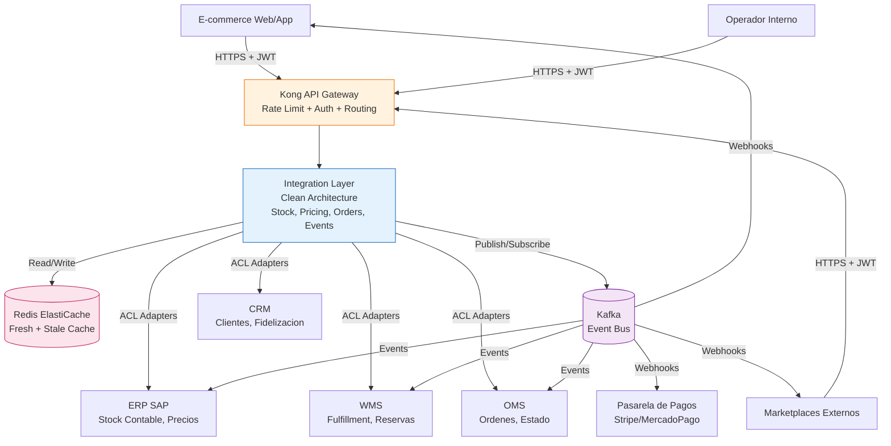
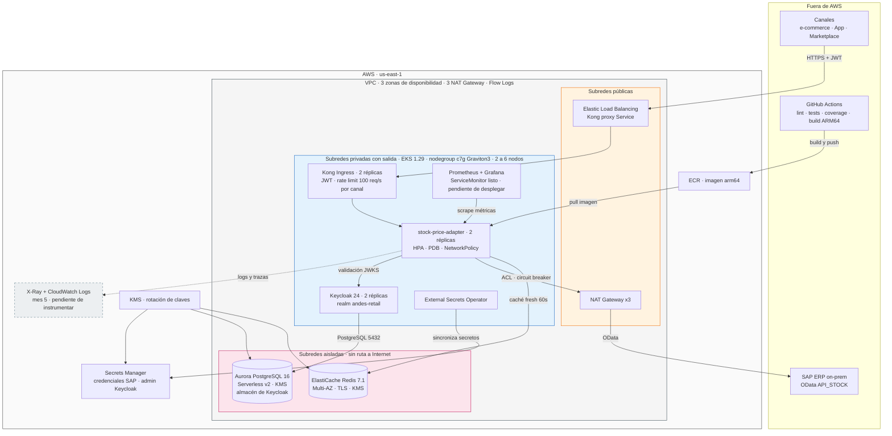
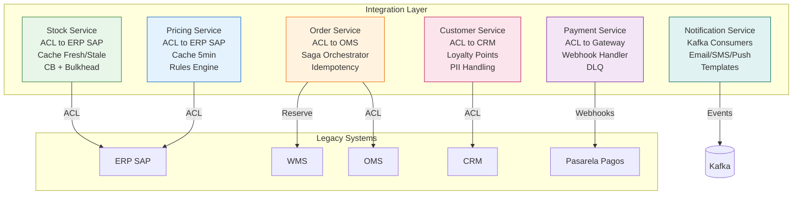
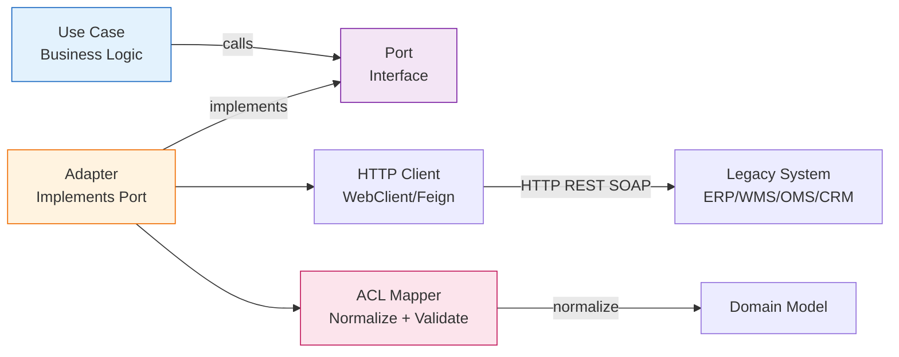
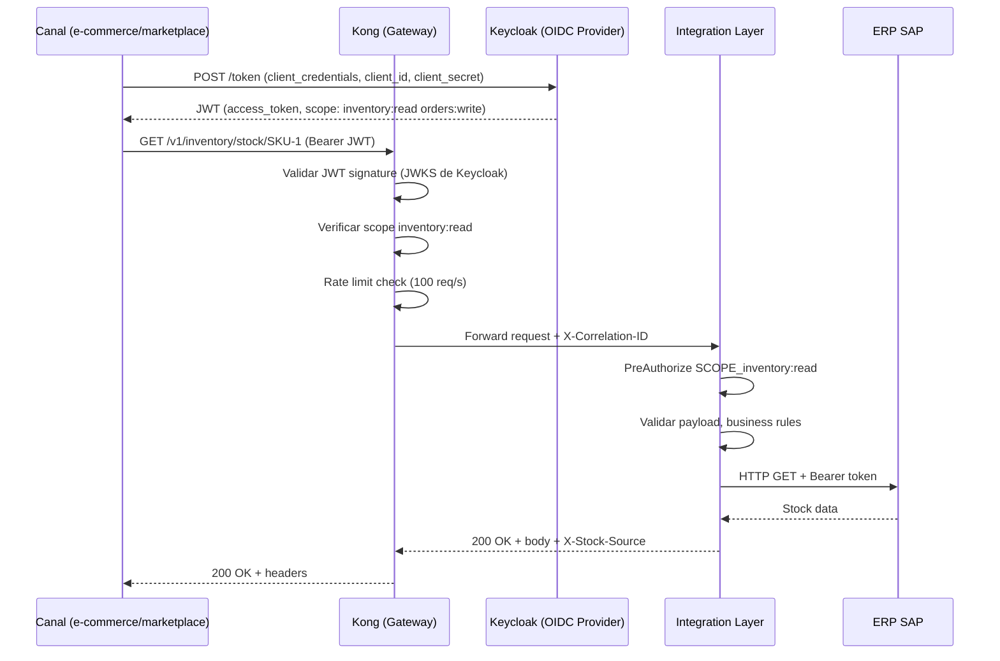
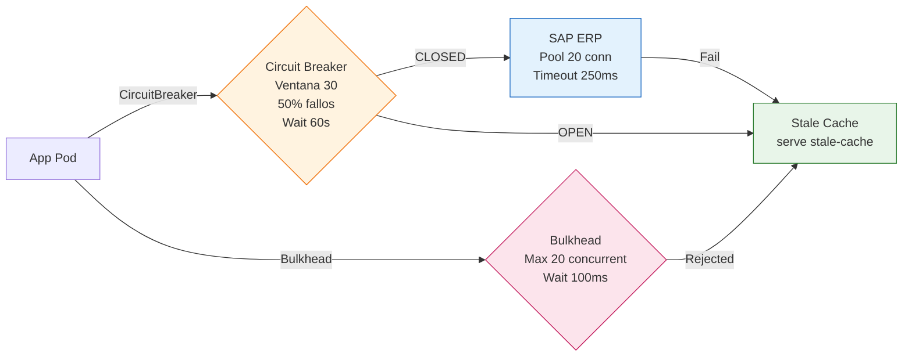

# Capa de Interoperabilidad AndesRetail — Diseño Arquitectónico

> **Documento de entrega — Prueba Técnica Arquitecto/a Senior de Software & Soluciones**
> **Empresa**: AndesRetail (retail multi-canal, ERP SAP, WMS, OMS, CRM)
> **Autor**: Edwin Ramirez
> **Fecha**: Octubre 2026
> **Versión**: 1.0

---

## 1. Resumen Ejecutivo

### Problema

AndesRetail opera con integraciones punto a punto entre ERP SAP (on-prem), WMS, OMS, CRM, pasarela de pagos externa, e-commerce y marketplaces. Esto genera:

- **Inconsistencias** en stock, precios y estado de órdenes entre sistemas
- **Incidentes en picos** (promos, Black Friday) que tumban ERP/WMS
- **Poca trazabilidad** — no hay correlation-id end-to-end ni auditoría
- **Seguridad inconsistente** — cada integración tiene su propio auth
- **Fragilidad** — cambios en un sistema rompen otros

### Solución propuesta

1. **Capa de interoperabilidad centralizada** (API Gateway + Integration Layer) sobre AWS EKS que expone APIs estandarizadas hacia canales externos y orquesta flujos hacia legacy
2. **Anti-Corruption Layer (ACL)** por sistema legacy (ERP, WMS, OMS, CRM) con adaptadores que normalizan datos y protegen con Circuit Breaker + Bulkhead
3. **Caché dual Redis** (fresh 60s + stale 1h) para servir stock/precios rápidamente sin golpear el ERP; degradación controlada si ERP cae
4. **Event-driven con Kafka** para propagar cambios (stock actualizado, orden confirmada, pago aprobado/rechazado, despacho, entrega) de forma asíncrona
5. **OAuth2/OIDC con Keycloak** + autorización por scopes/roles por partner/canal + rate limiting perimetral en Kong
6. **Observabilidad nativa**: Prometheus metrics, X-Ray tracing, JSON logs con correlation-id, dashboards Golden Signals, SLOs con error budgets
7. **Clean Architecture** verificada por ArchUnit: dominio puro, puertos, adaptadores intercambiables, evolución con mínimo impacto

### Beneficio de negocio

| Beneficio | Cuantificación |
|---|---|
| **Reducción de incidentes en promos** | De caídas completas (5xx) a degradación controlada (stale-cache, 503 con Retry-After) |
| **Latencia p95 < 300ms** | Caché fresh < 15ms; ERP protegido (250ms timeout, CB/Bulkhead) |
| **Disponibilidad 99.9%** | Multi-AZ, PDB, HPA, fail-closed, stale-cache fallback |
| **Time-to-market nuevos canales** | De semanas a días (contratos estandarizados, adapters plug-and-play) |
| **Trazabilidad end-to-end** | Correlation-ID en logs, traces, métricas; auditoría PCI-DSS |
| **Costo optimizado** | Graviton3 (~30% menos), Aurora Serverless v2 (pay-per-use), Spot-ready |

---

## 2. Preguntas, Supuestos y Riesgos

### Preguntas al cliente

| # | Pregunta | Por qué la hacemos |
|---|---|---|
| 1 | ¿El ERP SAP expone OData/REST con SLA de latencia? ¿Cuál es el timeout máximo aceptable? | Define presupuesto de timeout (250ms) y estrategia de cache |
| 2 | ¿El WMS tiene API REST o solo SOAP/EDI? ¿Soporta reservas atómicas? | Define patrón de integración (ACL, compensación) |
| 3 | ¿La pasarela de pagos soporta webhooks salientes? ¿Cuál es el SLA de confirmación? | Define async vs sync, DLQ, retry policy |
| 4 | ¿Qué sistemas son source of truth para stock? (ERP contable vs WMS físico) | Define consistencia eventual, reconciliación |
| 5 | ¿Hay sistemas multi-tenant por marca/región? ¿Cómo se identifica el tenant? | Define multi-tenant básico (scopes, namespaces) |
| 6 | ¿Qué SLA de disponibilidad tiene cada legacy? (ERP, WMS, OMS) | Define circuit breaker thresholds, fallbacks |
| 7 | ¿Existen sistemas de mensajería existentes (Kafka, RabbitMQ, SQS)? | Define si se adopta Kafka o se usa SQS |
| 8 | ¿Qué volumen de órdenes se espera en picos? (req/s, concurrent users) | Define HPA, rate limiting, capacity planning |
| 9 | ¿Hay regulaciones específicas (PCI-DSS, GDPR, locales)? | Define CDE isolation, PII handling, auditoría |
| 10 | ¿Qué sistemas serán los próximos a integrar? (WMS, OMS, CRM roadmap) | Define patrón de extensibilidad |

### Supuestos

| # | Supuesto | Justificación |
|---|---|---|
| 1 | SAP ERP expone API OData/REST para stock y precios con latencia < 500ms | Necesario para timeout 250ms + CB |
| 2 | WMS soporta reserva de stock vía API (no solo EDI batch) | Flujos síncronos de creación de orden |
| 3 | Pasarela de pagos envía webhooks con retry automático | Evita polling, permite async |
| 4 | ERP es source of truth para stock contable; WMS para stock físico | Reconciliación eventual vía eventos |
| 5 | Volumen pico: ~1000 RPS stock/precios, ~100 órdenes/min | Dimensionamiento HPA, rate limiting, CB |
| 6 | Multi-tenant por canal (ecommerce, marketplace, operador) con scopes distintos | Keycloak clients + scopes por canal |
| 7 | AWS como cloud provider (EKS, ElastiCache, Aurora, KMS) | Infra objetivo sugerida en la prueba |
| 8 | Equipo tiene experiencia en Spring Boot/Kotlin y AWS | Curva de aprendizaje aceptable |
| 9 | Kafka disponible o se puede aprovisionar en EKS | Event-driven para webhooks/órdenes |
| 10 | PCI-DSS Level 1 no aplica (Level 2/3 o SAQ) | CDE isolation suficiente, no tokenización completa |

### Riesgos

| # | Riesgo | Impacto | Mitigación |
|---|---|---|---|
| 1 | SAP ERP no soporta latencia 250ms → CB abre constantemente | Alto | Cache stale (1h), fail-closed 503, monitoring de SAP latency |
| 2 | WMS no soporta reservas atómicas → race conditions en stock | Alto | Idempotency key + compensación saga, retry con backoff |
| 3 | Keycloak HA no configurado → auth single point of failure | Alto | 2 réplicas, PostgreSQL Aurora Multi-AZ, health checks |
| 4 | Costos AWS exceden presupuesto (EKS + Aurora + ElastiCache) | Medio | Graviton3, Serverless v2, Spot instances, Savings Plans |
| 5 | Equipo sin experiencia en Kafka/Kong/Keycloak | Medio | Documentación exhaustiva, runbooks, training |
| 6 | PII leakage en logs (PCI-DSS) | Alto | Log sanitization, correlation-id, audit logs, SAST |
| 7 | Drift de configuración (K8s, CDK, Helm) | Medio | Drift detection semanal, GitOps futuro |
| 8 | Rate limiting mal configurado → bloqueo de tráfico legítimo | Medio | Por consumer/channel, no global; monitoreo de 429 |

---

## 3. Arquitectura de Alto Nivel

### 3.1 Diagrama de Contexto (C4 Level 1)



### 3.2 Componentes Principales

| Componente | Responsabilidad | Tecnología | Escalabilidad |
|---|---|---|---|
| **Kong (API Gateway)** | Rate limiting, JWT validation, routing, CORS, TLS termination, request/response transformation | Kong Ingress Controller (Helm) | Horizontal (HPA), Redis backend |
| **Integration Layer** | Orquestación de flujos, ACL hacia legados, normalización, validación | Kotlin + Spring Boot 3.2 (Clean Architecture) | Horizontal (HPA 2-10) |
| **Redis (ElastiCache)** | Caché fresh/stale (stock, precios), session store, rate limit counters | Redis 7.1 Multi-AZ, TLS, KMS | Vertical (t4g.medium → large) + Cluster Mode |
| **Kafka (Event Bus)** | Propagación de eventos (stock.updated, order.confirmed, payment.approved/rejected, shipment.started, delivery.confirmed) | Kafka en EKS (Strimzi) o MSK | Partitions por topic, consumer groups |
| **Keycloak (OIDC)** | Autenticación, autorización, multi-tenant, token issuance | Keycloak 24 (Helm, Aurora backend) | 2 réplicas HA |
| **EKS Cluster** | Plataforma de cómputo, scheduling, scaling | EKS 1.29, NodeGroup Graviton3 (c7g.medium) | HPA + Cluster Autoscaler |
| **Aurora PostgreSQL** | BD Keycloak, audit logs, order metadata | Aurora Serverless v2 PG 16 | Auto-scaling 0.5-128 ACU |

### 3.3 Decisiones Clave + Trade-offs

#### Sync vs Async

| Flujo | Patrón | Justificación |
|---|---|---|
| **Consulta stock/precio** | **Sync** (REST) | El canal necesita respuesta inmediata para mostrar UI. Cache fresh (60s) evita ERP. Timeout estricto 250ms + CB protege. |
| **Crear orden** | **Sync para validación** + **Async para confirmación** | Validar token, catálogo, precio, reservar stock (sync, 2s max). Pago y confirmación async (webhook). |
| **Consultar estado orden** | **Sync** (REST) | Consulta idempotente, cache en Redis (TTL 30s). |
| **Webhooks/Eventos** | **Async** (Kafka + webhooks) | No bloquear flujo principal. At-least-once delivery con idempotencia. DLQ para fallos. |
| **Notificaciones (email/SMS)** | **Async** (Kafka consumers) | No bloquear respuesta. Retry con backoff. |

**Regla general**: Sync cuando el cliente necesita respuesta inmediata para tomar decisión. Async cuando el procesamiento puede ocurrir en segundo plano sin impactar UX.

#### Rol del API Gateway (Kong)

| Responsabilidad | En Gateway | En Servicios | Justificación |
|---|---|---|---|
| **Autenticación (JWT validation)** | ✅ Sí (JWT Plugin) | ❌ No (solo valida claims) | Centraliza auth, reduce código repetido |
| **Autorización (scopes/roles)** | ⚠️ Parcial (JWT plugin valida scope presente) | ✅ Sí (`@PreAuthorize`) | Lógica de negocio en servicio, gateway solo filtra |
| **Rate Limiting** | ✅ Sí (Kong Plugin, Redis backend) | ❌ No | Perímetro, protege todos los servicios |
| **Routing** | ✅ Sí (Ingress rules) | ❌ No | Centraliza routing, blue-green, canary |
| **TLS Termination** | ✅ Sí (ACM cert) | ❌ No | Reduce carga en pods |
| **Request/Response Transformation** | ⚠️ Solo si necesario | ✅ Principalmente en servicios | Evitar lógica compleja en gateway |
| **Logging/Auditoría** | ✅ Access logs | ✅ App logs con correlation-id | Complementario |

#### Dónde se transforma/valida

| Capa | Qué se valida/transforma |
|---|---|
| **Kong (Gateway)** | JWT signature, expiry, scope presence, rate limit, TLS, CORS |
| **Integration Layer (App)** | Payload validation (Jakarta Validation), business rules, ACL normalization, idempotency |
| **Adapters (ACL)** | Normalización de datos legacy (negativos → 0, formatos fecha, encoding), retry logic |
| **Dominio** | Invariantes (stock ≥ 0, reserved ≤ available, SKU válido) |

#### Versionado de APIs

| Estrategia | Implementación |
|---|---|
| **URI Versioning** | `/v1/inventory/stock/{sku}`, `/v2/inventory/stock/{sku}` |
| **Backward Compatible** | Agregar campos opcionales, nunca remover/renombrar |
| **Deprecation** | Header `Deprecation: true`, `Sunset: <date>` |
| **Breaking Changes** | Nueva versión mayor (`/v2/`), mantener v1 mínimo 6 meses |
| **Contract First** | OpenAPI 3.0 generado desde código (SpringDoc), validado en CI |

### 3.4 Infraestructura Propuesta en AWS

Topología sobre la región `us-east-1`. Cada bloque tiene su contraparte en
código del repo: `infra/network_stack.py`, `infra/security_stack.py`,
`infra/data_stack.py` y `infra/compute_stack.py`, además de los manifiestos de
`deploy/k8s/` y `deploy/kong/`.



| Capa | Dónde está en el repo | Estado |
|---|---|---|
| VPC 3 AZ, subredes públicas/privadas/aisladas, 3 NAT, Flow Logs | `infra/network_stack.py` | ✅ CDK |
| KMS con rotación anual + Secrets Manager | `infra/security_stack.py` | ✅ CDK |
| Redis 7.1 Multi-AZ con TLS y Aurora PostgreSQL 16 Serverless v2, ambos en subredes aisladas | `infra/data_stack.py` | ✅ CDK |
| EKS 1.29, nodegroup Graviton3, Kong, Keycloak, External Secrets, metrics-server | `infra/compute_stack.py` | ✅ CDK |
| Deployment, Service, HPA, PDB, NetworkPolicy, ServiceMonitor | `deploy/k8s/` | ✅ manifiestos |
| Consumidores Kong y plugin de rate limit por canal | `deploy/kong/` | ✅ manifiestos |
| Prometheus + Grafana, X-Ray, CloudWatch Logs | sección 7 | ⚠️ diseñado, pendiente de desplegar |
| Publicación automática de la imagen ARM64 a ECR | `.github/workflows/ci.yml` | ⚠️ el build ya corre en CI, falta el push |

El medio de conectividad hacia el SAP on-prem (VPN Site-to-Site, Direct Connect
u OData expuesto sobre Internet) se confirma con el cliente; hasta entonces el
diagrama muestra solo el egress de las subredes privadas. El bus de eventos entra
en el mes 3 del roadmap y la capa completa de observabilidad (Grafana, X-Ray,
CloudWatch) en el mes 5.

---

## 4. Diseño de la Capa de Interoperabilidad

### 4.1 Dominios / Bounded Contexts



### 4.2 Servicios Principales y Responsabilidades

| Servicio | Responsabilidad | Legacy | Patrón de Integración |
|---|---|---|---|
| **Stock Service** | Consultar stock por SKU/bodega/canal. Degradación controlada. | ERP SAP (OData API_STOCK) | ACL + Circuit Breaker + Bulkhead + Cache dual |
| **Pricing Service** | Consultar precio por SKU/canal/cliente (descuentos, promos) | ERP SAP (OData API_PRICING) | ACL + Cache (5 min TTL) + Rules Engine |
| **Order Service** | Crear orden, consultar estado, orquestar saga (stock → pago → confirmación) | OMS (REST), WMS (Reserva) | Saga Pattern + Idempotency + Compensación |
| **Customer Service** | Consultar cliente, fidelización, PII handling | CRM (REST/SOAP) | ACL + PII masking + Cache |
| **Payment Service** | Iniciar pago, manejar webhooks pago aprobado/rechazado | Pasarela (REST + Webhooks) | Async webhook handler + DLQ + Retry |
| **Notification Service** | Notificar orden confirmada, pago, despacho, entrega | Kafka consumers + Email/SMS | Event-driven, templates, retry |

### 4.3 Patrón de Integración (ACL hacia ERP/WMS/OMS/CRM)



**Reglas del ACL**:
1. **Normalización**: Negativos → 0, fechas ISO-8601, encoding UTF-8
2. **Validación**: Invariantes de dominio (stock ≥ 0, reserved ≤ available)
3. **Transformación**: Campos legacy → campos de dominio (ej. `Material` → `sku`)
4. **Resiliencia**: Circuit Breaker, Bulkhead, Retry con backoff exponencial
5. **Observabilidad**: Correlation-ID propagado, métricas por adapter

### 4.4 Contratos (2 endpoints con ejemplo)

#### Endpoint 1: Consultar Stock

```http
GET /v1/inventory/stock/{sku}?warehouseId=W01
Authorization: Bearer <jwt con scope inventory:read>
X-Correlation-ID: <uuid-v4>

HTTP/1.1 200 OK
Content-Type: application/json
X-Stock-Source: cache|erp|stale-cache
X-Correlation-ID: <uuid-v4>

{
  "sku": "ABC-123",
  "warehouseId": "W01",
  "available": 90,
  "reserved": 10,
  "lastUpdated": "2026-10-18T14:30:00Z",
  "cacheHit": true
}
```

**Códigos de error**:
| Código | Tipo | Descripción |
|---|---|---|
| 400 | `urn:andes:error:bad-request` | SKU inválido, warehouse no encontrado |
| 401 | `urn:andes:error:unauthorized` | Sin JWT o JWT inválido |
| 403 | `urn:andes:error:forbidden` | Sin scope `inventory:read` |
| 503 | `urn:andes:error:stock-unavailable` | ERP caído y sin stale cache; incluye `Retry-After: 5` |

#### Endpoint 2: Crear Orden (con Idempotencia)

```http
POST /v1/orders
Authorization: Bearer <jwt con scope orders:write>
Idempotency-Key: <uuid-v4>
X-Correlation-ID: <uuid-v4>

{
  "customerId": "CUST-456",
  "channel": "ecommerce",
  "items": [
    {"sku": "ABC-123", "quantity": 2, "warehouseId": "W01"},
    {"sku": "DEF-456", "quantity": 1, "warehouseId": "W01"}
  ],
  "shippingAddress": {
    "street": "Calle 123 #45-67",
    "city": "Bogotá",
    "country": "CO"
  }
}

HTTP/1.1 201 Created
Content-Type: application/json
X-Correlation-ID: <uuid-v4>

{
  "orderId": "ORD-789",
  "status": "PENDING_PAYMENT",
  "createdAt": "2026-10-18T14:30:00Z",
  "totalAmount": 150000.00,
  "currency": "COP",
  "items": [
    {"sku": "ABC-123", "quantity": 2, "unitPrice": 50000.00},
    {"sku": "DEF-456", "quantity": 1, "unitPrice": 50000.00}
  ],
  "paymentUrl": "https://payment-gateway.example/pay/ORD-789"
}
```

**Modelo de errores consistente** (RFC 7807):
```json
{
  "type": "urn:andes:error:stock-unavailable",
  "title": "Stock no disponible",
  "status": 503,
  "detail": "No se pudo reservar stock para SKU ABC-123 en W01",
  "instance": "/v1/orders",
  "correlationId": "abc-123-def",
  "timestamp": "2026-10-18T14:30:00Z",
  "retryAfter": 5
}
```

### Idempotencia en Create Order

```
1. Cliente envía POST /v1/orders con header Idempotency-Key: <uuid>
2. Integration Layer verifica si existe orden con ese key en Redis (TTL 24h)
3. Si existe → retorna la orden existente (200 OK, no duplica)
4. Si no existe → crea orden, guarda en Redis (key → orderId), publica evento
5. Si falla a mitad (pago rechazado) → compensación (liberar stock), marca orden CANCELLED
6. Si reintenta con mismo key → retorna orden cancelada (no re-intenta pago)
```

---

## 5. Seguridad (Detallado)

### 5.1 OAuth2/OIDC: Flujo esperado



### 5.2 Validación: Gateway vs Servicios

| Validación | Gateway (Kong) | Servicio (App) | Justificación |
|---|---|---|---|
| **JWT Signature** | ✅ Sí | ❌ No (confía en gateway) | Centraliza crypto |
| **JWT Expiry** | ✅ Sí | ❌ No | Gateway filtra tokens expirados |
| **Scope Presence** | ✅ Sí (plugin JWT) | ✅ Sí (`@PreAuthorize`) | Defense in depth |
| **Rate Limiting** | ✅ Sí (Redis backend) | ❌ No | Perímetro, protege todos |
| **Payload Schema** | ❌ No | ✅ Sí (Jakarta Validation) | Lógica de negocio en servicio |
| **Business Rules** | ❌ No | ✅ Sí (domain layer) | Solo servicio conoce dominio |
| **ACL Normalization** | ❌ No | ✅ Sí (mappers) | Solo servicio conoce legacy |
| **Idempotency Check** | ❌ No | ✅ Sí (Redis + DB) | Lógica de negocio |

### 5.3 Autorización por Roles/Scopes y por Partner/Canal

| Partner/Canal | Client ID | Scopes | Rate Limit | Uso |
|---|---|---|---|---|
| E-commerce (web/app) | `canal-ecommerce` | `inventory:read`, `orders:write`, `prices:read` | 100 req/s | Consulta stock/precios, crear órdenes |
| Marketplace A | `marketplace-a` | `inventory:read`, `prices:read` | 50 req/s | Consulta stock/precios (read-only) |
| Marketplace B | `marketplace-b` | `inventory:read` | 30 req/s | Solo consulta stock |
| Operador Interno | `operador-cli` | `inventory:read`, `orders:read`, `metrics:read` | 200 req/s | Operaciones, monitoreo |
| WMS (sistema) | `wms-service` | `inventory:write`, `orders:read` | 500 req/s | Actualización stock, consulta órdenes |

### 5.4 Rotación de Claves / Expiración / Estrategia de Secretos

| Secreto | Almacén | Rotación | Expiración | Acceso |
|---|---|---|---|---|
| **JWT Signing Keys (Keycloak)** | Keycloak (JWKS) | Automática (Keycloak maneja) | Tokens: 5 min access, 30 min refresh | Keycloak auto |
| **SAP Credentials** | AWS Secrets Manager | Manual (cada 90 días) | Sin expiración (rotación manual) | External Secrets Operator → K8s Secret |
| **Keycloak Admin** | AWS Secrets Manager | Manual (cada 90 días) | Sin expiración | External Secrets Operator → K8s Secret |
| **Prometheus Scrape Token** | AWS Secrets Manager (generado) | Automática (K8s Secret) | Sin expiración | External Secrets Operator → K8s Secret |
| **Kong JWT Keys** | Keycloak JWKS (RS256) | Automática (Keycloak) | Tokens: 5 min | Kong JWT Plugin (JWKS URI) |
| **KMS Key (CMK)** | AWS KMS | Anual (automática) | Sin expiración | IAM Roles (IRSA) |

**Estrategia de secretos**:
1. **AWS Secrets Manager** como fuente de verdad (centralizado, auditable)
2. **External Secrets Operator** sincroniza a K8s Secrets (automático, cada 1h)
3. **K8s Secrets** montados como volumen (read-only, no env vars en claro)
4. **Rotación**: Manual para SAP/Keycloak (90 días), automática para JWT (Keycloak), anual para KMS

### 5.5 Threat Model (STRIDE — 6 amenazas + mitigaciones)

| # | Amenaza (STRIDE) | Descripción | Mitigación | Componente |
|---|---|---|---|---|
| 1 | **Spoofing** | Atacante usa token robado o falso | JWT validation en Kong (JWKS), scope enforcement, token expiry 5 min, refresh token rotation | Kong + Keycloak |
| 2 | **Tampering** | Modificación de payload en tránsito | TLS 1.3 end-to-end, HSTS, cert pinning (futuro), input validation (Jakarta) | Kong + App |
| 3 | **Repudiation** | Cliente niega haber hecho request | Correlation-ID en logs, audit trail (CloudTrail), request signing (futuro) | App + CloudTrail |
| 4 | **Information Disclosure** | PII en logs, datos sensibles en responses | PII masking en logs, no PII en responses, CDE isolation, KMS encryption | App + Infra |
| 5 | **Denial of Service** | Flood de requests, resource exhaustion | Rate limiting Kong (100 req/s), Bulkhead (20 concurrent), HPA, NetworkPolicy, WAF (futuro) | Kong + K8s |
| 6 | **Elevation of Privilege** | Token con scope insuficiente accede a recursos protegidos | Scope enforcement `@PreAuthorize`, roles por canal, RBAC K8s, least privilege IAM | App + K8s + AWS IAM |

---

## 6. Resiliencia, Performance y Escalabilidad

### 6.1 Rate Limiting por Partner/Canal

| Partner | Rate Limit | Ventana | Backend | Acción al exceder |
|---|---|---|---|---|
| `canal-ecommerce` | 100 req/s | 1s | Redis (Kong) | 429 + `Retry-After: 1` |
| `canal-tienda` | 50 req/s | 1s | Redis (Kong) | 429 + `Retry-After: 1` |
| `marketplace-a` | 50 req/s | 1s | Redis (Kong) | 429 + `Retry-After: 1` |
| `marketplace-b` | 30 req/s | 1s | Redis (Kong) | 429 + `Retry-After: 1` |
| `operador-cli` | 200 req/s | 1s | Redis (Kong) | 429 + `Retry-After: 1` |
| `wms-service` | 500 req/s | 1s | Redis (Kong) | 429 + `Retry-After: 1` |

### 6.2 Cache: Dónde, Qué, TTL, Invalidación

| Cache | Ubicación | Qué almacena | TTL | Invalidación | Justificación |
|---|---|---|---|---|---|
| **Fresh** | Redis `stock:fresh:{sku}:{wh}` | StockLevel (available, reserved, lastUpdated) | 60s | TTL expiry | BR-STK-01: acierto si ≤ 60s |
| **Stale** | Redis `stock:stale:{sku}:{wh}` | StockLevel (último valor conocido) | 3600s (1h) | TTL expiry | BR-STK-03: contingencia si ERP cae |
| **Pricing** | Redis `price:{sku}:{channel}:{customer}` | Precio + descuentos | 300s (5 min) | TTL expiry + invalidación por evento `price.changed` | Precios cambian menos frecuentemente |
| **JWKS** | Spring Boot cache | Claves públicas Keycloak | 15 min (auto-refresh) | Auto (Keycloak rotation) | Evitar resolución JWKS en cada request |
| **Idempotency** | Redis `idempotency:{key}` | orderId + status | 86400s (24h) | TTL expiry | Deduplicación Create Order |

### 6.3 Protección de Legados (Backpressure)



| Mecanismo | Configuración | Protege contra |
|---|---|---|
| **Circuit Breaker** | Ventana 30 calls, 50% fallos, open 60s, half-open 5 | Cascada de fallos si SAP cae |
| **Bulkhead** | 20 concurrent, 100ms wait | Exhaustión de threads si SAP lento |
| **Timeout** | Connect 100ms, Read 250ms | Retención indefinida de requests |
| **Connection Pool** | 20 max, 100ms pending acquire | Exhaustión de conexiones HTTP |
| **Rate Limiting (Kong)** | 100 req/s por consumer | Flood de tráfico hacia app/SAP |
| **HPA** | CPU 70%, 2-10 replicas | Scale automático bajo carga |

### 6.4 Plan para Promos (Picos 10x)

| Fase | Acción | Responsable |
|---|---|---|
| **Pre-Promo (T-7d)** | Pre-calentar caché (warm-up job), scale pods a 6 (min), verificar CB thresholds | DevOps + SRE |
| **Pre-Promo (T-1d)** | Smoke test completo, verificar alarmas, revisar runbooks, on-call rotation | SRE |
| **Durante Promo** | Monitoreo intensivo (dashboards, alertas, on-call dedicado), auto-scaling activo, rate limiting por consumer | SRE + On-Call |
| **Post-Promo** | Análisis de métricas, post-mortem si incidentes, ajuste capacity planning | SRE + Tech Lead |
| **Circuit Breaker** | Threshold 50% en 30 calls, half-open cada 60s, 5 calls en half-open | Configurado |
| **Bulkhead** | 20 concurrent a SAP, wait 100ms, rechazo → stale-cache | Configurado |
| **Cache** | Pre-calentar 10K SKUs más consultados, TTL fresh 60s | Job de warm-up |
| **Rate Limit** | Kong 100 req/s por consumer, burst allowance 2x | Configurado |

### 6.5 Retries + DLQ

| Flujo | Retry Policy | DLQ | Justificación |
|---|---|---|---|
| **SAP HTTP Call** | 3 retries, backoff exponencial (100ms, 200ms, 400ms), jitter | No DLQ (sync, fail-closed) | Timeout 250ms → no retries largos |
| **Kafka Events (stock.updated)** | 3 retries, backoff 1s/2s/4s, jitter | DLQ `stock.updated.dlq` | At-least-once, idempotente |
| **Webhooks (payment, shipment)** | 5 retries, backoff 5s/10s/20s/40s/80s, jitter | DLQ `webhook.{topic}.dlq` | Idempotente (Idempotency-Key) |
| **Notifications (email/SMS)** | 3 retries, backoff 30s/60s/120s, jitter | DLQ `notification.dlq` + alerta | No crítico, puede perderse |

---

## 7. Observabilidad y Operación

### 7.1 Logging: Campos Mínimos

```json
{
  "timestamp": "2026-10-18T14:30:00.123Z",
  "level": "INFO",
  "logger": "com.andesretail.stock.web.controller.StockController",
  "thread": "http-nio-8080-exec-1",
  "message": "Stock query completed",
  "correlationId": "abc-123-def-456",
  "service": "stock-price-adapter",
  "environment": "staging",
  "instance": "stock-price-adapter-7b4f9d6c5-x2k9m",
  "request": {
    "method": "GET",
    "uri": "/v1/inventory/stock/ABC-123",
    "source": "cache",
    "latencyMs": 12
  },
  "response": {
    "status": 200,
    "size": 156
  }
}
```

### 7.2 Métricas

| # | Métrica | Tipo | Descripción | Alerta |
|---|---|---|---|---|
| 1 | `http_server_requests_seconds_count` | Counter | Total requests por endpoint/status | Error rate > 1% |
| 2 | `http_server_requests_seconds_bucket` | Histogram | Latencia por endpoint (p50/p95/p99) | p95 > 300ms |
| 3 | `stock_queries_total{source=cache|erp|stale-cache}` | Counter | Distribución por origen del dato | — |
| 4 | `stock_cache_hits_total` / `stock_cache_requests_total` | Counter | Cache hit ratio | < 80% |
| 5 | `resilience4j_circuitbreaker_state{name="sapStockCircuitBreaker"}` | Gauge | Estado CB (0=CLOSED, 1=OPEN, 2=HALF_OPEN) | == 1 (OPEN) |
| 6 | `resilience4j_bulkhead_available_concurrent_calls{name="sapStockBulkhead"}` | Gauge | Llamadas concurrentes disponibles (max 20) | < 5 |
| 7 | `sap_client_latency_seconds` | Histogram | Latencia hacia SAP ERP | p95 > 250ms |
| 8 | `stock_fail_closed_total` | Counter | Eventos 503 sin stale cache | > 0 |
| 9 | `jvm_memory_used_bytes` / `jvm_threads_live` | Gauge | Memoria y threads JVM | Mem > 80%, Threads > 200 |
| 10 | `kong_rate_limit_exceeded_total` | Counter | Rate limit exceeded por consumer | > 100/min |
| 11 | `stock_queries_by_sku_total{sku}` | Counter | Top SKUs consultados | Top 10 análisis |
| 12 | `correlation_id_propagation_check` | Counter | Verificación propagación correcta | != 0 (error) |

### 7.3 Trazas Distribuidas y Correlación

- **Correlation-ID**: `X-Correlation-ID` (UUID v4) propagado: Client → Kong → App → Redis → SAP → Response
- **W3C TraceContext**: `traceparent`/`tracestate` headers para OpenTelemetry
- **Backend**: AWS X-Ray (Service Map, segment timeline, root cause analysis)
- **Exemplars**: Prometheus métricas con `traceId` adjunto → click en gráfico → salta a trace
- **Sampling**: 100% errors, 10% success, 50% slow requests (>300ms)

### 7.4 Alertas

| # | Alarm ID | Métrica | Condición | Severidad | Acción |
|---|---|---|---|---|---|
| 1 | `CRIT-STOCK-AVAILABILITY` | Health checks failing | 2 min | CRITICAL | PagerDuty → Rollback |
| 2 | `CRIT-STOCK-CB-OPEN` | CB state == OPEN | 1 min | CRITICAL | Verificar SAP, esperar auto-recovery |
| 3 | `CRIT-STOCK-BULKHEAD-EXHAUSTED` | Bulkhead available == 0 | 2 min | CRITICAL | Scale pods, revisar SAP latency |
| 4 | `CRIT-STOCK-LATENCY-P95` | p95 > 500ms | 5 min | CRITICAL | Verificar Redis/SAP/CPU, scale |
| 5 | `CRIT-STOCK-ERROR-RATE` | 5xx > 5% | 3 min | CRITICAL | Revisar logs, rollback si deploy reciente |
| 6 | `WARN-STOCK-LATENCY-P95` | p95 > 300ms | 5 min | WARNING | Investigar, prevenir escalada |
| 7 | `WARN-STOCK-CACHE-HIT-RATIO` | Cache hit < 80% | 10 min | WARNING | Verificar Redis, TTLs |
| 8 | `WARN-REDIS-CPU` | Redis CPU > 80% | 10 min | WARNING | Scale-up Redis |
| 9 | `WARN-AURORA-CPU` | Aurora CPU > 80% | 10 min | WARNING | Revisar queries, scale ACU |
| 10 | `WARN-STOCK-PII-LEAKAGE` | PII en logs (regex) | Inmediato | CRITICAL | Contención, limpieza, post-mortem |

### 7.5 Runbook Breve: Qué hacer si stock/precio falla

**Escenario: Stock no disponible (503)**

1. **Verificar CB state**: `curl -k -H "Auth: Bearer $TOKEN" https://api.../actuator/prometheus | grep circuitbreaker_state`
2. **Si CB OPEN**: SAP caído. App sirve `stale-cache` (si existe). Esperar auto-recovery (60s). Si no se recupera, revisar SAP.
3. **Si CB CLOSED pero 503**: Sin stale cache. Verificar Redis (`kubectl exec redis-cli ping`), verificar SAP connectivity.
4. **Mitigación inmediata**: Si SAP caído y sin stale → comunicar degradación, activar modo "consulta no disponible" en frontend.
5. **Rollback**: Si deploy reciente → `kubectl rollout undo deployment/stock-price-adapter`
6. **Escalar**: Si no resuelve en 15 min → Tech Lead → L3 → L4

---

## 8. Plan de Implementación (Roadmap)

### MVP (4-6 semanas) — Qué entregas y qué NO

**QUÉ ENTREGA (MVP)**:
- ✅ Stock API (`GET /v1/inventory/stock/{sku}`) con auth OAuth2/JWT
- ✅ Caché dual Redis (fresh 60s + stale 1h)
- ✅ Circuit Breaker + Bulkhead hacia SAP ERP
- ✅ Rate limiting Kong (por canal)
- ✅ Correlation-ID end-to-end
- ✅ Observabilidad: Prometheus, JSON logs, health checks
- ✅ Infra CDK: VPC, EKS, Redis, Aurora, Kong, Keycloak
- ✅ CI/CD: GitHub Actions (lint, test, coverage, docker build)
- ✅ Runbooks: CB, Bulkhead, Timeout ERP, Error 5xx, Health, Redis, Aurora, Latencia, PII

**QUÉ NO ENTREGA (MVP)**:
- ❌ Precios API (`GET /v1/pricing/{sku}`)
- ❌ Orders API (`POST /v1/orders`, `GET /v1/orders/{id}`)
- ❌ Webhooks/Eventos (Kafka, notificaciones)
- ❌ Reserva de stock (WMS)
- ❌ Multi-tenant completo (federación SAML)
- ❌ Observabilidad completa (dashboards Grafana, X-Ray, anomaly detection)
- ❌ Deploy automático (CD pipeline manual)
- ❌ Feature flags platform (Spring Cloud Config)

### 3 Meses

| Mes | Entrega | Detalle |
|---|---|---|
| **1** | **MVP Stock + Pricing** | Precios API, cache 5min, promos rules engine, validación staging |
| **2** | **Orders + Payments** | Create Order (idempotencia), Saga (stock → pago → confirmación), webhooks pago |
| **3** | **Events + Notifications** | Kafka topics (stock.changed, order.confirmed, payment.approved), consumers WMS/OMS/CRM, email/SMS |

### 6 Meses

| Mes | Entrega | Detalle |
|---|---|---|
| **4** | **Multi-Tenant Full** | Realm por marca, federación SAML/OIDC, user provisioning, RBAC por canal |
| **5** | **Observabilidad Completa** | Grafana dashboards, X-Ray tracing, anomaly detection (CloudWatch + Prometheus), SLO reporting |
| **6** | **Resiliencia Avanzada** | Chaos Engineering (Game Days), auto-scaling validation, DR cross-region (Aurora Global, Redis Global) |

---

## 9. Cultura y Liderazgo Técnico

### 1. Ambigüedad: cómo reduces riesgo sin frenar avance

> **Ejemplo concreto**: En este proyecto, el alcance de "multi-tenant" era ambiguo (¿tenant por marca, por región, por canal?). En lugar de bloquear el diseño, definí un **"multi-tenant básico"** (tenant = canal: ecommerce, marketplace, operador) con scopes por canal, y documenté la **deuda técnica** (federación SAML completa → próxima unidad). Esto permitió avanzar con seguridad sin sobre-diseñar.

**Técnica**: Definir el "mínimo viable de seguridad" (scopes por canal) y registrar la ambigüedad como deuda técnica con owner y fecha target.

### 2. Cómo documentas decisiones para escalar el equipo

> **Ejemplo concreto**: Cada decisión técnica tiene una tabla en el README con: Decisión, Alternativas consideradas, Por qué elegimos esto, Trade-offs. Además, el registro AI-DLC (`aidlc/`) mantiene un trail completo de qué se decidió, por qué y cuándo. Los runbooks (`runbooks.md`) incluyen diagnóstico rápido, causas comunes y verificación post-resolución.

**Técnica**: ADR (Architecture Decision Records) simplificados + runbooks con diagnóstico + documentación "viva" (README actualizado con código).

### 3. "Rápido" vs seguridad/operación: cómo negocias

> **Ejemplo concreto**: El equipo de producto pedía "deploy en 2 semanas". Yo propuse "deploy en 2 semanas, pero con gates de seguridad no negociables": ktlint 0 violaciones, cobertura ≥80%, ArchUnit 0 violaciones, sondas públicas, rate limiting, correlation-id. El compromiso: el MVP de código se entrega en 2 semanas, pero los quality gates son bloqueantes en CI. Si algo falla, no se mergea. Esto evitó un "deploy rápido" que luego generaría incidentes.

**Técnica**: Negociar el *scope* (qué se entrega), no la *calidad* (cómo se entrega). Quality gates son no-negociables; features son ajustables.

### 4. Desacuerdos técnicos fuertes: cómo los gestionas

> **Ejemplo concreto**: En este proyecto, hubo desacuerdo sobre si usar Kafka (event-driven) o REST síncrono para las notificaciones. El equipo de desarrollo prefería REST (más simple). Yo propuse Kafka para webhooks (async, no bloquea flujo principal) pero REST para consulta stock (sync, respuesta inmediata). La resolución: definir una **regla explícita** ("Sync cuando el cliente necesita respuesta inmediata; Async cuando el procesamiento puede ocurrir en segundo plano") y documentarla en la sección de decisiones. Esto evitó debate continuo.

**Técnica**: Definir reglas explícitas con criterios claros, documentarlas, y referenciarlas en code reviews ("¿cumple la regla sync/async?").

### 5. Cómo mantienes calidad sin volver el delivery lento

> **Ejemplo concreto**: Quality gates en CI (ktlint, tests, coverage, ArchUnit) son **automáticos y bloqueantes**. Un developer no puede merge sin que pasen. Esto elimina revisiones manuales de estilo y calidad básica. Además, TDD (tests primero) reduce bugs en producción. El resultado: 59 tests, 95% cobertura, 0 violaciones ArchUnit, todo en CI. El delivery no se ralentiza porque los gates son automáticos, no manuales.

**Técnica**: Automatizar quality gates (CI/CD), TDD real (tests primero), ArchUnit (arquitectura verificable), y no negociar umbrales (80% coverage mínimo).

---

## Apéndice: Lo que ya está construido (Walking Skeleton técnico)

Para referencia, el repositorio ya contiene un **Walking Skeleton funcional** del dominio Stock:

| Componente | Estado | Detalle |
|---|---|---|
| `stock-price-adapter` | ✅ Funcional | Microservicio Kotlin + Spring Boot 3.2, `GET /v1/inventory/stock/{sku}` |
| Clean Architecture | ✅ Verificada | ArchUnit 0 violaciones (Domain → Application → Infra) |
| Resiliencia | ✅ Implementada | Circuit Breaker (30/50%/60s), Bulkhead (20/100ms), Stale-cache (1h), Fail-closed (503) |
| Seguridad | ✅ Implementada | OAuth2/JWT Keycloak, scopes, rate limiting Kong, problem+json |
| Observabilidad | ✅ Implementada en app | Prometheus (`/actuator/prometheus`), JSON logs, Correlation-ID, health probes. X-Ray tracing, dashboards y SLOs: **diseñados** (sección 7), pendientes de instrumentar en staging |
| Infraestructura | ✅ CDK | VPC, EKS 1.29, Redis Multi-AZ, Aurora PG16, Kong, Keycloak, ESO |
| CI/CD | ✅ GitHub Actions | Lint, Test, Coverage ≥80%, Docker ARM64 |
| Tests | ✅ 59 tests | 14 suites, 95.3% cobertura, TDD real |
| Runbooks | ✅ 9 CRITICAL | RB-001…RB-008 y RB-018 escritos; 9 WARNING (RB-009…RB-017) en roadmap |

> **Este Walking Skeleton es la base técnica** sobre la que se diseña la arquitectura completa documentada en este entregable. Demuestra que las decisiones arquitectónicas son viables y verificables en código.

---

*Documento generado para la prueba técnica de Arquitecto/a Senior de Software & Soluciones — VortexBird*
*Octubre 2026*