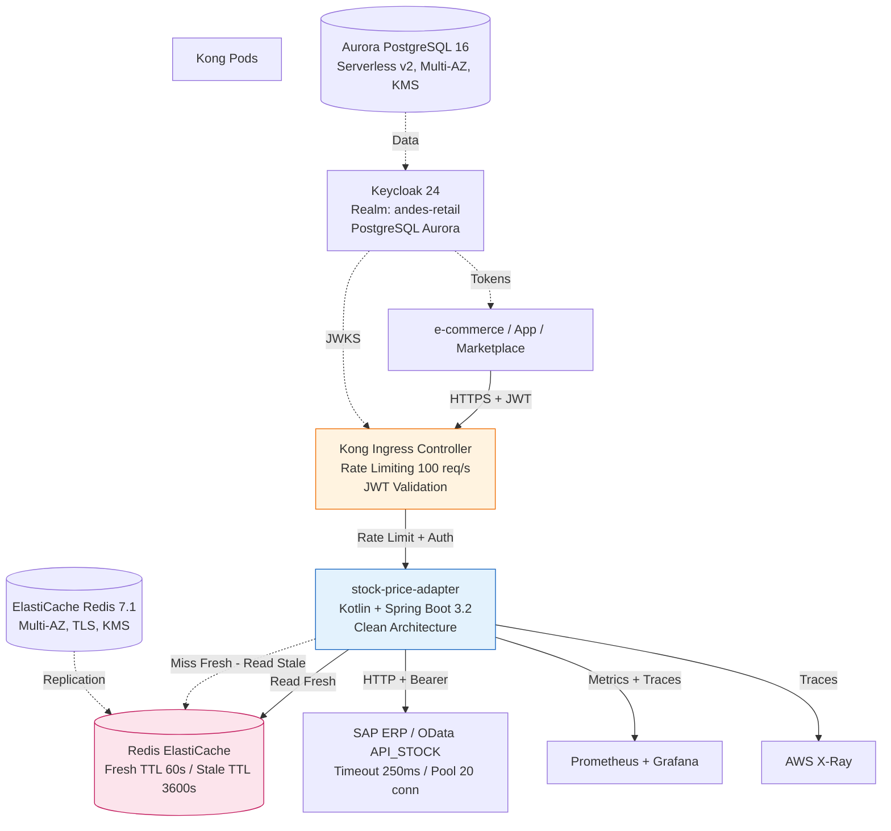
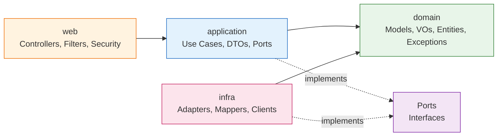

# Andes Retail — Capa de Integración de Stock

> El diseño completo está en [`ARCHITECTURE.md`](./ARCHITECTURE.md): 9 secciones con los diagramas, las decisiones y el plan de crecimiento.

> **Qué es este repositorio.** Es el primer incremento del proyecto que conecta los canales digitales de Andes Retail con sus sistemas internos. No es un prototipo ni una maqueta: es un pedazo real del sistema, funcionando de punta a punta, que sirve para comprobar en código que las decisiones de arquitectura se sostienen antes de construir el resto.

---

## Por qué existe

Andes Retail vende por varios canales (la tienda web, la aplicación, los marketplaces) y todos ellos necesitan lo mismo: saber cuánto stock hay, a qué precio y si una compra se puede registrar. Hoy cada canal pregunta directamente al ERP, que es un sistema antiguo pensado para otro volumen de consultas. En una promo fuerte esas consultas se multiplican y el ERP se cae. Y cuando el ERP se cae, se cae la venta completa.

Este primer entregable resuelve el caso más doloroso y más frecuente: **consultar stock**. Lo hace poniendo una capa intermedia entre el canal y el ERP, que guarda los datos en memoria, controla cuánto tráfico llega y, sobre todo, sigue respondiendo cuando el ERP no contesta.

Un detalle que parece menor y no lo es: si el ERP está caído, el sistema no devuelve un error. Devuelve el último stock conocido, marcándolo como tal. Mostrar un stock de hace media hora es mucho mejor que mostrarle un error al cliente que está por comprar.

## Qué quedó funcionando

| Pieza | Qué resuelve | Estado |
|---|---|---|
| **Servicio de stock** | Microservicio en Kotlin y Spring Boot que responde cuánto stock hay de un producto en una bodega. Cada consulta pasa por autenticación: no responde a quien no tenga permiso. | Funcional, con pruebas y documentación |
| **Infraestructura como código** | Toda la plataforma se describe en archivos, no se arma a mano: red separada por niveles de exposición, clúster de contenedores, caché con redundancia, base de datos, gestión de credenciales. | Se despliega con un comando |
| **Configuración del clúster** | Los archivos que definen cómo se ejecuta el servicio: cuántas instancias, cuándo escalar, cómo se aísla de otros servicios, cómo se expone. | Listos para aplicar |
| **Integración continua** | Cada cambio pasa automáticamente por revisión de estilo, pruebas y un mínimo de cobertura. Si no cumple, no se fusiona. Además se construye la imagen del servicio. | Pipeline en verde |
| **Observabilidad** | El servicio reporta métricas, escribe registros estructurados y expone verificaciones de salud. Los tableros de monitoreo, la trazabilidad detallada y los objetivos de servicio están diseñados y documentados; falta instrumentarlos en el ambiente real. | Funcionando en el servicio, documentado para el resto |
| **Procedimientos de incidente** | Qué hacer paso a paso cuando falla cada cosa crítica: el ERP deja de responder, el cupo de llamadas se agota, aparecen errores. | 9 procedimientos críticos escritos |

> **Esto no es el sistema completo.** Es el hilo que va de un extremo al otro, con la profundidad justa para validar la arquitectura, las tecnologías y la forma de operar antes de invertir en el resto. Lo que falta está listado al final.

---

## Cómo está armado

### Vista general



El canal nunca habla con el ERP. Habla con la capa nueva, que decide de dónde sacar el dato y qué hacer cuando el sistema de atrás no responde.

### Cómo se organiza el código



El punto central es que **el corazón del sistema no sabe que existe Spring, Redis ni el ERP**. Solo conoce las reglas del negocio. Todo lo externo se conecta por enchufes intercambiables. Eso significa que cambiar Redis por otra cosa, o el ERP por otro, no obliga a tocar la lógica. Esta regla no queda en un documento: se verifica automáticamente en cada build y hoy no hay ninguna violación.

---

## Decisiones que vale la pena explicar

| Qué se decidió | Qué se evaluó antes | Por qué quedó así |
|---|---|---|
| **Kotlin con Spring Boot** | Java, Quarkus, Micronaut | El equipo ya trabaja con Spring, así que no hay curva de aprendizaje grande. Kotlin reduce bastante el código repetitivo y la versión de Spring es la actual, con soporte a largo plazo. |
| **Organización del código por responsabilidad, verificada automáticamente** | Capas tradicionales, sin verificación | La regla de que el negocio no depende de nadie se comprueba en cada build. Sin esa verificación, en seis meses cualquier atajo la rompe. |
| **Dos niveles de caché, no uno** | Un solo nivel con un tiempo de vida | Es lo que permite no mostrarle nunca un stock en cero a un cliente solo porque el ERP falló. El dato reciente sirve para operar; el de respaldo, para sobrevivir a una caída. |
| **Corte automático hacia el ERP** | Confiar en reintentos, hacerlo a mano | Un servicio que ya está mal no se arregla insistiéndole. El corte automático deja de llamar cuando detecta fallos y evita arrastrar la caída. |
| **Keycloak con base de datos gestionada** | Keycloak en un contenedor local, Cognito, Auth0 | Los datos de autenticación no pueden vivir en algo efímero. Necesitan respaldo, cifrado y redundancia desde el primer día. |
| **Kong en la puerta de entrada** | Balanceador de AWS, otros proxys | Permite limitar el tráfico por cliente de forma nativa, y las reglas se declaran en archivos en lugar de configurarse a mano. |
| **Base de datos que escala sola** | Base de datos con capacidad fija | El sistema tiene horas de mucho uso y horas de poco. Pagar por capacidad reservada las 24 horas no tiene sentido para este patrón. |
| **Procesadores ARM en el clúster** | Procesadores tradicionales | Rinden más por el mismo dinero y el servicio ya está preparado para esa arquitectura. |
| **Formato estándar de errores** | El formato por defecto del framework | Con un formato único, cualquier canal entiende cualquier error sin tener que interpretar estructuras distintas según el caso. |
| **Un identificador de seguimiento por petición** | Registros sueltos sin relación | Es lo que permite reconstruir la historia completa de una compra cuando algo sale mal. Sin eso, investigar un problema es adivinar. |

---

## Qué gana el negocio

**Menos caídas en los momentos que más importan.** Cuando el ERP se satura, el sistema sigue vendiendo. Solo se bloquea la consulta cuando de verdad no hay ningún dato guardado, que es el caso poco frecuente.

**Respuesta rápida.** La mayoría de las consultas se resuelve en memoria, sin tocar el ERP. Cuando hay que consultarlo, hay un límite de espera estricto para que su lentitud no llegue al cliente.

**Nada de errores confusos.** El cliente ve si hay stock o no. Nunca ve un error técnico porque un sistema interno esté teniendo un mal día.

**Integrar un canal nuevo deja de ser un proyecto.** Un canal nuevo se conecta a algo que ya existe. Antes, cada integración se diseñaba desde cero.

**Poder responder qué pasó.** Cada operación queda registrada de forma tal que se puede reconstruir su recorrido. Necesario para auditoría y para resolver reclamos con datos, no con suposiciones.

**Costo bajo control.** Se paga por lo que se usa, y la plataforma se dimensiona según la demanda real del día.

**Seguridad desde el diseño, no como parche.** Todo pasa por un mismo control de identidad, con permisos distintos por canal, cifrado en tránsito y en reposo, y sin datos personales en los registros.

---

## Qué falta

| Prioridad | Qué sigue | En qué consiste |
|---|---|---|
| **1** | Desplegar en el ambiente de pruebas y probar bajo carga | Levantar la infraestructura y ejecutar las pruebas de carga ya planificadas para confirmar el comportamiento real. |
| **2** | Reserva de stock | Poder apartar stock en el momento de la compra, no solo consultarlo. Es el paso previo a registrar órdenes. |
| **3** | Separación completa por marca | Cada marca con sus propios usuarios y permisos, y conexión con el sistema de identidad que la empresa ya tenga. |
| **4** | Actualización de stock por eventos | Que los cambios de stock se avisen solos a los demás sistemas en lugar de consultarse. |
| **5** | Despliegue automático | Que los cambios lleguen al ambiente productivo sin intervención manual. |
| **6** | Recuperación ante caída de una región entera | Poder operar desde otra región si la principal queda fuera de servicio. |
| **7** | Pruebas deliberadas de fallos | Provocar caídas controladas cada cierto tiempo para comprobar que el sistema responde como se espera. |

---

## Dónde está cada cosa

| Qué buscas | Dónde está |
|---|---|
| Código del servicio | `services/stock-price-adapter/src/main/kotlin/com/andesretail/stock/` |
| Pruebas | `services/stock-price-adapter/src/test/kotlin/com/andesretail/stock/` |
| Infraestructura | `infra/app.py`, `infra/network_stack.py`, `infra/security_stack.py`, `infra/data_stack.py`, `infra/compute_stack.py` |
| Configuración del clúster | `deploy/k8s/`, `deploy/kong/`, `deploy/k8s/monitoring/` |
| Integración continua | `.github/workflows/ci.yml` |
| Procedimientos de incidente | `aidlc/spaces/default/intents/261016-andes-retail-interop/operation/incident-response/runbooks.md` |
| Tableros, alertas y objetivos de servicio | `aidlc/spaces/default/intents/261016-andes-retail-interop/operation/observability-setup/` |
| Plan de pruebas de carga | `aidlc/spaces/default/intents/261016-andes-retail-interop/operation/performance-validation/load-test-plan.md` |
| Análisis de costos | `aidlc/spaces/default/intents/261016-andes-retail-interop/operation/feedback-optimization/cost-analysis.md` |
| Detección de desviaciones | `aidlc/spaces/default/intents/261016-andes-retail-interop/operation/feedback-optimization/drift-report.md` |
| Diseño completo | `ARCHITECTURE.md` |

---

## Cómo se levanta

```bash
# Entorno local (requiere Docker)
docker compose -f deploy/local/docker-compose.yml up -d
./gradlew :services:stock-price-adapter:bootRun

# Pruebas completas con verificación de cobertura
./gradlew ktlintCheck test jacocoTestCoverageVerification jacocoTestReport --no-daemon

# Construir la imagen para procesadores ARM
docker buildx build --platform linux/arm64 -t stock-price-adapter:local -f services/stock-price-adapter/Dockerfile .

# Desplegar la infraestructura (requiere credenciales de AWS)
cd infra
python -m venv .venv && source .venv/bin/activate
pip install -r requirements.txt
cdk deploy --all --profile andes-staging

# Aplicar la configuración del clúster
kubectl apply -k deploy/k8s/
kubectl apply -k deploy/kong/
kubectl apply -k deploy/k8s/monitoring/

# Pruebas de carga
k6 run load-test.js -e BASE_URL=https://api.andes-retail.example -e TOKEN=<jwt>
```
