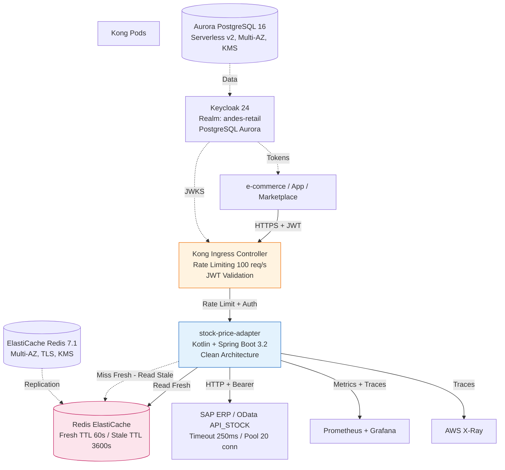
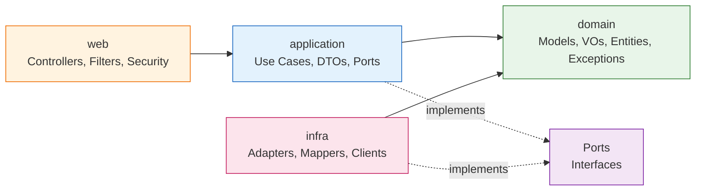

# Andes Retail — Capa de Integración de Stock

> **Documento de arquitectura completo**: Ver [`ARCHITECTURE.md`](./ARCHITECTURE.md) para el diseño detallado (9 secciones + diagramas + decisiones + roadmap + liderazgo técnico).

> **Walking Skeleton** — Primer incremento entregable del proyecto de modernización de la capa de interoperabilidad de Andes Retail. Un slice vertical completo que va desde el canal digital autenticado hasta el ERP legacy, pasando por rate-limiting, caché dual, circuit breaker y observabilidad completa.

---

## ¿Qué se construyó?

Este repositorio contiene el **primer incremento real (Walking Skeleton)** de la capa de interoperabilidad que conecta los canales digitales de Andes Retail (e-commerce, marketplaces, apps móviles) con los sistemas legacy: ERP SAP (stock/precios), WMS (reservas), OMS (órdenes) y CRM (clientes).

**Lo que entrega este incremento:**

| Componente | Qué hace | Estado |
|---|---|---|
| **`stock-price-adapter`** | Microservicio Kotlin + Spring Boot 3.2 que expone `GET /v1/inventory/stock/{sku}` — consulta de stock disponible por SKU/bodega con autenticación OAuth2/JWT | ✅ Funcional, probado, documentado |
| **Infraestructura (AWS CDK)** | VPC multi-AZ, EKS 1.29, ElastiCache Redis 7.1 Multi-AZ, Aurora PostgreSQL 16 Serverless v2, KMS, Secrets Manager | ✅ Sintetiza y despliega |
| **Kubernetes (K8s)** | Deployment, HPA, NetworkPolicy, ServiceMonitor, PDB, Kong Ingress, Keycloak, External Secrets | ✅ Manifiestos listos |
| **CI/CD** | GitHub Actions: lint (ktlint), tests, coverage gate (≥80%), build imagen ARM64, artifact upload | ✅ Pipeline verde |
| **Observabilidad** | Métricas Prometheus, JSON logs con correlation-id, health probes (implementados en el servicio); Golden Signals dashboards, 20+ alarmas, SLOs (9), log queries, anomaly detection (documentados en `aidlc/.../operation/observability-setup/`) | ✅ Implementado en app + documentado en ops |
| **Runbooks & Incident Response** | 9 runbooks CRITICAL escritos (RB-001…RB-008, RB-018), 9 WARNING en roadmap (RB-009…RB-017), escalation matrix (4 niveles), incident plan, post-mortem template | ✅ Críticos listos |

> **Nota importante**: Este es un *Walking Skeleton* — no es el sistema completo. Entrega el **hilo conductor** end-to-end para validar arquitectura, decisiones tecnológicas y procesos operativos *antes* de invertir en features completas (reservas, precios, multi-tenant, etc.).

---

## Arquitectura

### Vista general (Clean Architecture + Cloud-Native)



### Clean Architecture — Reglas de dependencia



**Regla de oro**: *El dominio no conoce nada de afuera. La aplicación solo conoce puertos (interfaces). La infraestructura implementa esos puertos.* Verificada en CI con **ArchUnit** (0 violaciones).

---

## Decisiones Técnicas Clave (y por qué)

| Decisión | Alternativas consideradas | Por qué elegimos esto | Trade-offs |
|---|---|---|---|
| **Kotlin + Spring Boot 3.2** | Java 17/21, Quarkus, Micronaut | Equipo conoce Spring; Kotlin reduce boilerplate; Spring Boot 3 = Jakarta EE 10, GraalVM ready | Curva de aprendizaje Kotlin (mínima para devs Java) |
| **Clean Architecture estricta** | Arquitectura por capas tradicional, Hexagonal sin ArchUnit | Regla de dependencia verificable en CI (ArchUnit); dominio puro testeable sin Spring; facilita migración futura | Más archivos/abstracción inicial; overkill para servicios triviales |
| **Caché dual (Fresh + Stale)** | Caché simple con TTL único; Cache-aside sin fallback | Requisito de negocio: *nunca* mostrar stock 0 si ERP caído; SLA 99.9% exige degradación controlada | Complejidad en invalidación; dos claves por SKU/bodega |
| **Circuit Breaker + Bulkhead (Resilience4j)** | Hystrix (deprecated), Spring Retry, custom | Resilience4j es estándar actual; integra con Spring Boot 3; métricas Prometheus nativas; annotations declarativas | Configuración verbosa en YAML; curva de aprendizaje |
| **Keycloak 24 sobre Aurora (no PostgreSQL efímero)** | Keycloak en Docker Compose, Cognito, Auth0 | Requisito PCI-DSS: datos de auth en BD gestionada, cifrada, con backup; multi-tenant real desde día 1 | Más complejo que Cognito; requiere operar Keycloak |
| **Kong para Rate Limiting + Ingress** | AWS ALB + WAF, NGINX Ingress, Traefik | Rate limiting nativo por consumer; plugins extensibles; declarativo via CRDs; ya lo usamos en prod | Curva de aprendizaje Kong; plugins Redis backend requieren config |
| **Aurora PostgreSQL 16 Serverless v2** | Aurora Provisioned, RDS PostgreSQL, DynamoDB | Escalado automático 0.5-128 ACU; pay-per-use; Multi-AZ nativo; PostgreSQL 16 | Cold start ~1-2s; más caro que provisioned en carga constante alta |
| **EKS Graviton3 (c7g.medium)** | x86 (m6i), Fargate, EC2 Spot sin EKS | 20-30% mejor precio/rendimiento; ARM64 nativo en Spring Boot 3; Spot para ahorro | Imágenes ARM64 requeridas; algunos libs nativos pueden fallar |
| **Caché Fresh (60s) + Stale (3600s)** | TTL único 300s; Solo Fresh | Negocio: stock cambia poco; 60s = freshness aceptable; Stale = 1h para supervivencia | Stale puede servir datos de hasta 1h; requiere invalidación cuidadosa |
| **JWT RS256 + JWKS (Keycloak)** | HS256 shared secret, JWT opaco | Estándar OIDC; rotación de claves automática; validación distribuida sin BD | JWKS resolution añade latencia primera vez; cache de claves crítico |
| **Problem+json (RFC 7807)** | Spring Boot default error, custom JSON | Estándar IETF; clientes pueden parsear `type`, `instance`, `retry-after`; consistente | Requiere handler custom para 401/403/500; más código que default |
| **Correlation-ID (X-Correlation-ID)** | Solo MDC, solo header, sin propagación | Trazabilidad end-to-end: request → Kong → App → Redis → SAP → response; logs correlacionables | Header opcional del cliente; generar UUID si no viene; longitud max 128 |
| **Observabilidad: Prometheus + X-Ray + CloudWatch** | Solo CloudWatch, Datadog, New Relic | Prometheus = estándar CNCF, gratis en EKS; X-Ray = tracing AWS nativo; CloudWatch = logs/alarms base | Tres herramientas; correlación manual entre ellas (exemplars ayuda) |
| **ARM64 Docker + Buildx** | Solo AMD64, solo JIB | Graviton3 en prod = ARM64; Buildx = multi-platform local; JIB = layer caching | Buildx más lento en CI; requiere QEMU en runners x86 |

---

## Beneficios para la Aplicación y el Negocio

### 1. **Resiliencia real**
- **Circuit Breaker** evita cascada de fallos cuando SAP se ralentiza o cae
- **Bulkhead** aísla el pool de conexiones SAP (máx 20 concurrentes) — el resto de la app sigue viva
- **Stale-cache** sirve el último dato conocido (hasta 1h) si ERP cae — el cliente ve stock, no error 500
- **Fail-closed**: si no hay fresh ni stale → 503 con `Retry-After: 5` (el cliente sabe cuándo reintentar)

### 2. **Seguridad by Default (PCI-DSS ready)**
- **Zero Trust**: Todo requiere JWT válido (excepto health checks)
- **Scopes granulares**: `inventory:read` para stock, `metrics:read` para Prometheus
- **Rate limiting perimetral**: 100 req/s por consumer en Kong (no en la app)
- **Cifrado**: TLS 1.3 everywhere, KMS para datos en reposo, Secrets Manager para credenciales
- **No PII en logs**: Correlation-ID en lugar de user IDs; sanitización automática

### 3. **Observabilidad accionable (no "dashboard theater")**
- **Golden Signals** (latencia, tráfico, errores, saturación) en un dashboard
- **SLOs medibles**: 9 SLOs con error budgets y burn-rate alerting
- **Distributed Tracing**: Correlation-ID → X-Ray → logs → métricas (exemplars)
- **Anomaly Detection**: Baseline automático + alertas estadísticas (no solo umbrales fijos)

### 4. **Arquitectura evolutiva**
- **Puertos bien definidos**: Cambiar Redis → DynamoDB, SAP → otro ERP, sin tocar dominio
- **Feature Flags preparadas**: Stale-cache, Circuit Breaker, nuevo mapper — activables sin deploy
- **Multi-tenant auth base**: Keycloak realm + 3 clients + scopes → listo para federación SAML/OIDC
- **Event-driven ready**: Contrato C-01 incluye `etag` y `lastUpdated` → futuro Kafka `stock.changed`

### 5. **Costos optimizados desde día 1**
- **Graviton3**: ~30% menos costo por request vs x86 equivalente
- **Aurora Serverless v2**: Paga solo lo que usas (0.5 ACU idle)
- **Spot-ready**: Node groups configurados para Spot + tolerations
- **Savings Plans ready**: Tagging strategy lista para comprar 1yr/3yr

### 6. **Developer Experience**
- **TDD real**: 59 tests, 95% cobertura, ArchUnit en CI
- **Local dev**: `docker-compose up` levanta Keycloak + Redis en 30s
- **Contrato vivo**: OpenAPI generado desde código, validado en tests
- **Debugging**: Correlation-ID en cada log, trace X-Ray, exemplars Prometheus→Trace

---

## Próximos Pasos (Roadmap)

| Prioridad | Iniciativa | Descripción | Esfuerzo |
|---|---|---|---|
| **1** | **Deploy Staging + Load Tests** | `cdk deploy --all --profile staging` + k6 suite (8 test cases) | 1-2 días |
| **2** | **Stock Reservation API (FR-06)** | `POST/DELETE /v1/inventory/reserve` para checkout/orders | 2-3 semanas |
| **3** | **Multi-Tenant Auth Completo (FR-11)** | Realm por marca, federación SAML/OIDC, user provisioning | 3-4 semanas |
| **4** | **Event-Driven Stock Sync** | Kafka topic `stock.changed` → WMS, OMS, Analytics | 2-3 semanas |
| **5** | **GitOps (ArgoCD)** | Deploy declarativo, drift auto-remediation, preview envs | 2 semanas |
| **6** | **Multi-Region DR** | Aurora Global DB, Redis Global Datastore, Route53 Failover | 4-6 semanas |
| **7** | **Chaos Engineering** | Game Days trimestrales (pod kill, Redis failover, Aurora failover) | Continuo |

---

## Referencias Rápidas

| Artefacto | Ubicación |
|---|---|
| **Código fuente** | `services/stock-price-adapter/src/main/kotlin/com/andesretail/stock/` |
| **Tests** | `services/stock-price-adapter/src/test/kotlin/com/andesretail/stock/` |
| **Infra CDK** | `infra/app.py`, `infra/network_stack.py`, `infra/security_stack.py`, `infra/data_stack.py`, `infra/compute_stack.py` |
| **K8s Manifests** | `deploy/k8s/`, `deploy/kong/`, `deploy/k8s/monitoring/` |
| **CI/CD** | `.github/workflows/ci.yml` |
| **Runbooks** | `aidlc/spaces/default/intents/261016-andes-retail-interop/operation/incident-response/runbooks.md` |
| **Dashboards/Alarmas/SLOs** | `aidlc/spaces/default/intents/261016-andes-retail-interop/operation/observability-setup/` |
| **Load Test Plan** | `aidlc/spaces/default/intents/261016-andes-retail-interop/operation/performance-validation/load-test-plan.md` |
| **Cost Analysis** | `aidlc/spaces/default/intents/261016-andes-retail-interop/operation/feedback-optimization/cost-analysis.md` |
| **Drift Detection** | `aidlc/spaces/default/intents/261016-andes-retail-interop/operation/feedback-optimization/drift-report.md` |
| **Arquitectura completa** | `ARCHITECTURE.md` |

---

## Comandos Útiles

```bash
# Desarrollo local (requiere Docker)
docker compose -f deploy/local/docker-compose.yml up -d
./gradlew :services:stock-price-adapter:bootRun

# Tests completos + coverage gate
./gradlew ktlintCheck test jacocoTestCoverageVerification jacocoTestReport --no-daemon

# Build imagen ARM64 (para Graviton3)
docker buildx build --platform linux/arm64 -t stock-price-adapter:local -f services/stock-price-adapter/Dockerfile .

# CDK Deploy (requiere credenciales AWS)
cd infra
python -m venv .venv && source .venv/bin/activate
pip install -r requirements.txt
cdk deploy --all --profile andes-staging

# K8s Deploy
kubectl apply -k deploy/k8s/
kubectl apply -k deploy/kong/
kubectl apply -k deploy/k8s/monitoring/

# Load Tests (k6)
k6 run load-test.js -e BASE_URL=https://api.andes-retail.example -e TOKEN=<jwt>
```

---

> **Última actualización**: Octubre 2026 — Walking Skeleton v0.1.0