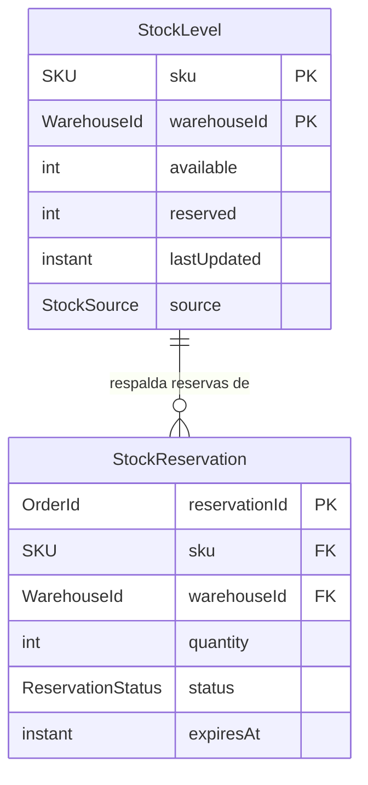
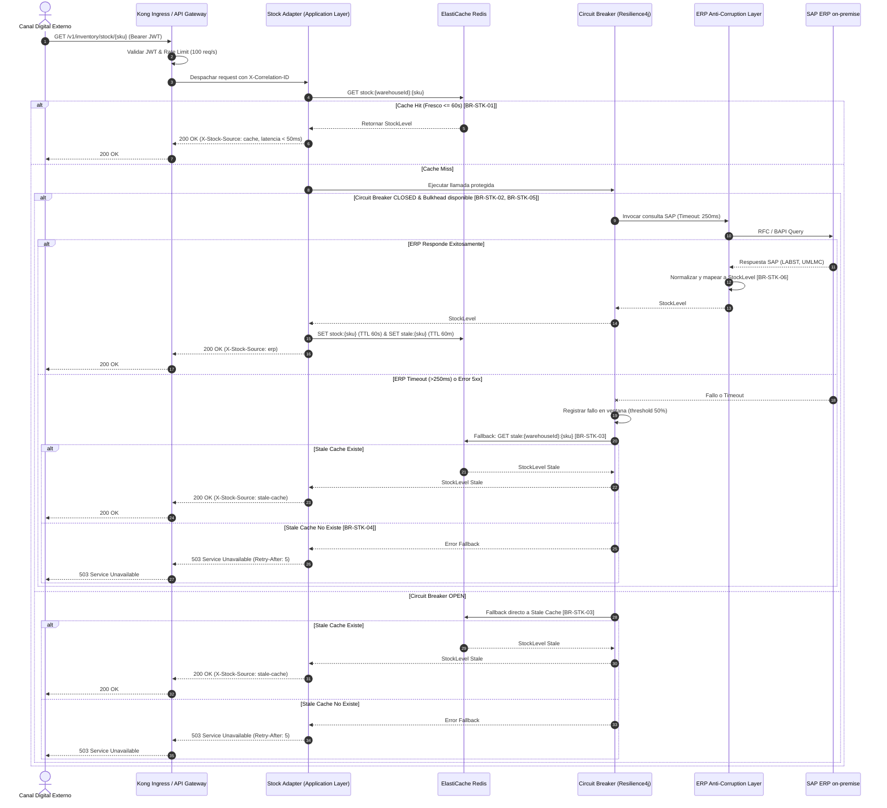
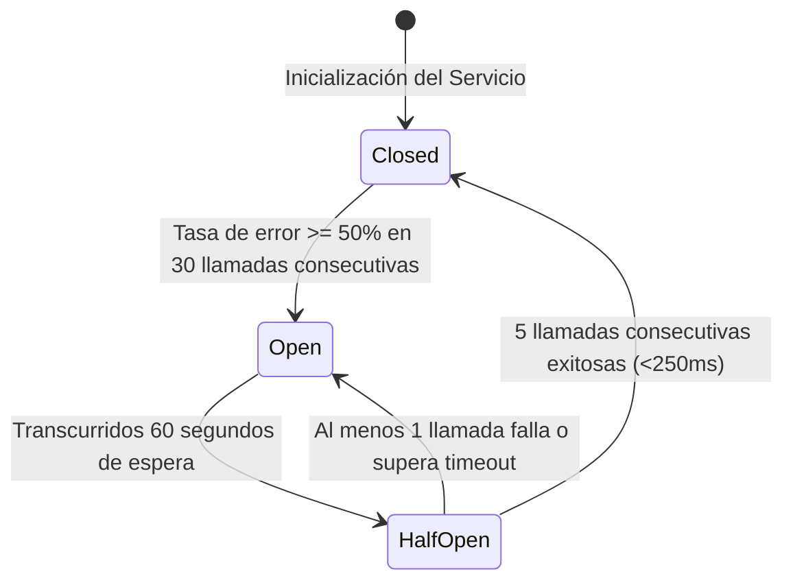

## Sources

- [desc] Initial description del proyecto Andes Retail.
- [FR-01, FR-11] Requerimientos funcionales en requirements.md.
- [NFR-01, NFR-10, NFR-12] NFRs de latencia, CB y Bulkhead.
- [CA-02, CA-03] Restricciones de backpressure y Clean Architecture.
- [entities.md] Modelo de entidades del stage actual.
- [rules.md] Reglas de negocio del stage actual.
- [C-01, C-05, C-09] Contratos en contract-summary.md.

---

# Especificación Funcional — `skeleton-stock-query` (Walking Skeleton)

Esta especificación describe la arquitectura funcional, el flujo de procesamiento de consultas de stock, el diagrama entidad-relación y las máquinas de estado para el microservicio `stock-price-adapter`.

---

## 1. Diagrama Entidad-Relación (ER)



---

## 2. Flujo de Ejecución de Consulta de Stock



---

## 3. Máquina de Estados del Circuit Breaker



---

## 4. Interfaces de Puertos y Adaptadores (Clean Architecture)

```kotlin
// Puerto de Entrada (Application Layer)
interface GetStockUseCase {
    fun execute(sku: SKU, warehouseId: WarehouseId): StockLevel
}

// Puerto de Salida hacia Caché (Domain / Application Layer)
interface StockCachePort {
    fun get(sku: SKU, warehouseId: WarehouseId): StockLevel?
    fun getStale(sku: SKU, warehouseId: WarehouseId): StockLevel?
    fun save(stockLevel: StockLevel, ttlSeconds: Long)
}

// Puerto de Salida hacia ERP Legacy (Domain / Application Layer)
interface ErpStockPort {
    fun queryStockFromErp(sku: SKU, warehouseId: WarehouseId): StockLevel
}
```

---

## 5. Resumen de Reglas de Negocio Aplicadas

| ID Regla | Nombre | Impacto en el Flujo |
|---|---|---|
| **BR-STK-01** | Prioridad de Caché | Resuelve 90%+ de peticiones en < 50ms [NFR-01] |
| **BR-STK-02** | Circuit Breaker | Aísla caídas del ERP en ventana de 30 llamadas |
| **BR-STK-03** | Stale Cache Fallback | Garantiza disponibilidad continua con cabecera de transparencia |
| **BR-STK-04** | Fail-Closed | Responde 503 RFC 7807 sin inventar datos |
| **BR-STK-05** | Bulkhead ERP | Limita a 20 llamadas simultáneas protegiendo al ERP [NFR-12] |
| **BR-STK-06** | Normalización SAP | Elimina valores negativos o nulos provenientes de SAP |

---

## Assumptions & Open Questions

- [assumption] La implementación de Spring Boot utiliza `Resilience4j-spring-boot3` para decoradores declarativos `@CircuitBreaker` y `@Bulkhead`.
- [assumption] Las métricas del Circuit Breaker se exportan automáticamente a Prometheus mediante el módulo `micrometer-registry-prometheus`.
