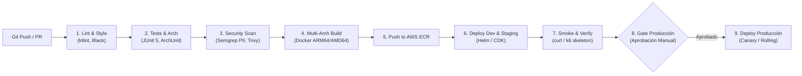

## Sources

- [desc] Initial description del proyecto Andes Retail.
- [team-practices] Prácticas afirmadas en team.md y project.md (TDD, ktlint, cobertura >= 80%, aprobación manual prod).
- [CA-01, CA-03] PCI-DSS PII scan y Clean Architecture ArchUnit.

---

# Diseño de Pipeline CI/CD — `skeleton-stock-query`

Este documento describe la arquitectura y etapas del pipeline de integración continua y despliegue continuo (CI/CD) para el microservicio `stock-price-adapter` y los stacks de CDK.

---

## 1. Flujo General del Pipeline (GitHub Actions / CodePipeline)



---

## 2. Definición Detallada de Etapas de Integración Continua (CI)

| Etapa | Herramienta | Comando / Ejecutable | Criterio de Falla (Bloqueo de PR) |
|---|---|---|---|
| **1. Verificación de Formato** | `ktlint` | `./gradlew ktlintCheck` | Cualquier error de estilo o convención no resuelto [team.md] |
| **2. Pruebas Unitarias & TDD** | `JUnit 5 + JaCoCo` | `./gradlew test jacocoTestReport` | Cualquier test en rojo o cobertura de líneas < 80% [NFR-14] |
| **3. Pruebas de Arquitectura** | `ArchUnit` | Incluido en `./gradlew test` | Violación de la Dependency Rule de Clean Architecture [CA-03] |
| **4. Escaneo de PII & Secretos**| `Semgrep + GitGuardian` | `semgrep --config p/ci` | Detección de patrones PAN o PII en logs y código [CA-01, NFR-05] |
| **5. Escaneo de Vulnerabilidades**| `Trivy` | `trivy image --severity HIGH,CRITICAL` | Presencia de CVEs críticas en imagen base o librerías |
| **6. Compilación de Contenedor**| `Docker Buildx` | `docker buildx build --platform linux/arm64` | Fallo de compilación nativa en ARM64 Graviton |

---

## 3. Estrategia de Despliegue Continuo (CD)

- **Despliegue a Staging:** Automático ante cada merge a la rama `main` tras pasar todas las etapas de CI.
- **Verificación de Despliegue (Smoke Test):** Ejecución automatizada de llamada curl autenticada contra `/v1/inventory/stock/SKU-COL-001` verificando respuesta 200 en < 300ms.
- **Pase a Producción:** Requiere **aprobación manual formal** en el entorno de GitHub / AWS CodePipeline por parte del Tech Lead y el Product Owner de Andes Retail [project.md].

---

## 4. Snippet Ilustrativo GitHub Actions Workflow (≤15 líneas)

```yaml
# Ilustrativo (≤15 líneas): Pipeline CI básico para stock-price-adapter
name: CI Stock Adapter
on: [push, pull_request]
jobs:
  build-and-test:
    runs-on: ubuntu-latest
    steps:
      - uses: actions/checkout@v4
      - uses: actions/setup-java@v4
        with: { distribution: 'temurin', java-version: '21' }
      - name: Build with Gradle & Verify Coverage
        run: ./gradlew ktlintCheck test jacocoTestCoverageVerification
      - name: Scan PII Patterns with Semgrep
        run: semgrep --config "p/owasp-top-ten" --error
```

---

## Assumptions & Open Questions

- [assumption] Las imágenes de contenedor se almacenan en repositorios privados de **AWS ECR** con escaneo continuo de vulnerabilidades habilitado (*scan on push*).
