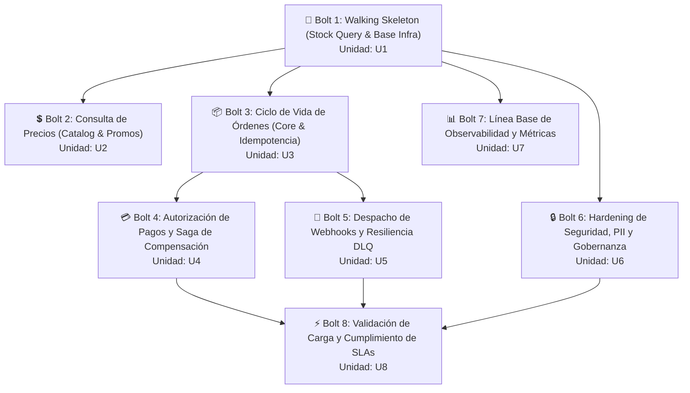

## Sources

- [desc] Initial description del proyecto Andes Retail.
- [scope] Scope document y intent backlog.
- [team-practices] Prácticas afirmadas en team.md y project.md (Walking Skeleton, TDD, squash-merge).
- [U1] a [U8] del units.md de units-generation.
- [C-01] a [C-09] del contract-summary.md de contract-design.
- [DP-Q1] a [DP-Q4] del delivery-planning-questions.md.

---

# Plan de Entrega por Bolts — Andes Retail Interoperability Platform

Este documento define la secuencia ordenada de **Bolts** (un ciclo de construcción sobre una porción del trabajo que culmina en algo ejecutable y verificable) para la fase de Construcción de la Plataforma de Integración y Eventos (PIE).

La secuencia respeta el principio de **walking skeleton** (un corte vertical delgado de punta a punta que recorre toda la arquitectura hasta funcionar de forma integrada) establecido en las reglas del equipo (`team.md`), garantizando que la infraestructura base y la conectividad crítica queden probadas antes de abordar la lógica de órdenes y pagos.

---

## Secuencia General de Bolts

---

## Detalle de Cada Bolt

---

### Bolt 1: `bolt-01-walking-skeleton`
- **Unidad de Trabajo:** `skeleton-stock-query` (U1)
- **Tipo de Artefacto:** `service`
- **Marcador Walking Skeleton:** **Sí** (Hito obligatorio antes de construir órdenes)
- **Definición de Terminado (DoD):**
  1. Infraestructura base CDK aprovisionada (VPC con subredes privadas, cluster EKS Graviton, RDS Aurora Serverless v2, ElastiCache Redis, Amazon EventBridge, AWS Secrets Manager, Kong Ingress).
  2. Servicio Keycloak operativo para emisión de tokens JWT bajo OAuth2 `client_credentials`.
  3. Microservicio `stock-price-adapter` implementado con Clean Architecture en Kotlin/Spring Boot (capas domain, application, infrastructure).
  4. Endpoint público `GET /v1/inventory/stock/{sku}` respondiendo llamadas autenticadas con latencia p95 < 300ms.
  5. Anti-Corruption Layer (ACL) integrado hacia ERP on-premise (o mock de alta fidelidad) protegido por Circuit Breaker (Resilience4j), Bulkhead de 20 hilos y caché Redis con TTL de 60s [CA-02].
  6. Pruebas unitarias con JUnit 5 siguiendo TDD y cobertura de líneas >= 80%.
- **Hipótesis de Confianza:**
  > "Una llamada autenticada desde un canal externo resuelve el stock en menos de 300ms p95, y ante la indisponibilidad o latencia excesiva del ERP, el Circuit Breaker conmuta de inmediato a los datos en caché de Redis reportando `X-Stock-Source: stale-cache` sin degradar la disponibilidad ni bloquear hilos."
- **Demostración Esperada:**
  Ejecución de un cliente HTTP autenticado con Bearer token consultando el stock de un SKU; simulación de caída de red hacia el ERP demostrando la apertura del Circuit Breaker y la entrega transparente del valor en caché con cabecera `stale-cache`.

---

### Bolt 2: `bolt-02-catalog-price`
- **Unidad de Trabajo:** `price-query` (U2)
- **Tipo de Artefacto:** `service`
- **Marcador Walking Skeleton:** No
- **Definición de Terminado (DoD):**
  1. Endpoint público `GET /v1/catalog/price/{sku}` integrado en el servicio de catálogo/inventario.
  2. Lógica de dominio para segmentación por canal (`channelId`) y cliente (`customerSegment`), aplicando listas de precios y descuentos promocionales vigentes.
  3. Manejo de dinero monetario en centavos COP (`amountInCents`, integer int64) según ADR-01.
  4. Caché de precios en Redis y pruebas unitarias con cobertura >= 80%.
- **Hipótesis de Confianza:**
  > "Las consultas de precios vigentes y promocionales responden en <= 300ms p95, calculando los importes exactos en centavos sin discrepancias de punto flotante entre canales."
- **Demostración Esperada:**
  Consultas simultáneas con segmentos `REGULAR` y `VIP` reflejando tarifas diferenciadas y promociones temporales con formato estandarizado.

---

### Bolt 3: `bolt-03-orders-core`
- **Unidad de Trabajo:** `order-lifecycle` (U3)
- **Tipo de Artefacto:** `service`
- **Marcador Walking Skeleton:** No
- **Definición de Terminado (DoD):**
  1. Microservicio `order-service` estructurado bajo Clean Architecture (entidad agregada `Order`, value objects `OrderId`, `Money`, `PaymentToken`).
  2. Endpoint `POST /v1/orders` para creación de órdenes con validación de esquema y dirección.
  3. Idempotencia dual implementada con Redis (primera línea rápida) y tabla transaccional en Aurora PostgreSQL (garantía durable de 24h) [ADR-05].
  4. Outbox Pattern implementado en tabla `outbox_events` en la misma transacción ACID de la orden, publicando `order.confirmed` en Amazon EventBridge [ADR-02].
  5. Endpoint `GET /v1/orders/{orderId}` con validación estricta de aislamiento multi-tenant (`tenantId`).
  6. Enmascaramiento de datos personales (PII) en registros de aplicación y `toString()` de `PaymentToken` redactado [ADR-06, CA-01]. Cobertura >= 80%.
- **Hipótesis de Confianza:**
  > "La creación de orden garantiza idempotencia estricta ante reintentos de red, registra la transacción atómicamente con el evento de salida, y previene cualquier fuga de PII o datos sensibles en los logs del sistema."
- **Demostración Esperada:**
  Creación exitosa de una orden recibiendo código 201; reenvío del mismo request con el mismo `Idempotency-Key` retornando 200/201 con cabecera `Idempotency-Replay: true` sin duplicar registros; inspección de logs verificando enmascaramiento.

---

### Bolt 4: `bolt-04-payment-and-saga`
- **Unidad de Trabajo:** `payment-authorization` (U4)
- **Tipo de Artefacto:** `service`
- **Marcador Walking Skeleton:** No
- **Definición de Terminado (DoD):**
  1. Microservicio `payment-service` desplegado en subred privada CDE aislada cumpliendo PCI-DSS [CA-01].
  2. Implementación del puerto interno `PaymentPort` (`POST /internal/v1/payments/authorizations`) procesando exclusivamente tokens del PSP (sin PANs).
  3. Orquestación de la Saga en `Order Service`: reserva de stock vía `StockPort` → autorización de cobro vía `PaymentPort`.
  4. Compensación automática de Saga: si el pago es rechazado, liberación inmediata del stock reservado en el ERP y Redis en <= 5s [FR-06].
  5. Emisión de eventos `payment.approved` y `payment.rejected` a EventBridge. Cobertura >= 80%.
- **Hipótesis de Confianza:**
  > "Cuando una autorización de pago es declinada por la pasarela, el mecanismo de compensación libera automáticamente la reserva de inventario en menos de 5 segundos, evitando reservas huérfanas y desincronización de stock."
- **Demostración Esperada:**
  Simulación de orden con token de pago que genera rechazo (`insufficient_funds`); verificación de liberación automática del stock en el ERP y actualización de la orden a `PAYMENT_FAILED`.

---

### Bolt 5: `bolt-05-notification-webhooks`
- **Unidad de Trabajo:** `notification-webhooks` (U5)
- **Tipo de Artefacto:** `service`
- **Marcador Walking Skeleton:** No
- **Definición de Terminado (DoD):**
  1. Microservicio `notification-service` con consumidores SQS suscritos a reglas de Amazon EventBridge para eventos `order.confirmed`, `payment.approved`, `payment.rejected`.
  2. Despacho HTTP POST hacia los endpoints HTTPS de los canales con firma criptográfica HMAC-SHA256 en la cabecera `X-Hub-Signature-256`.
  3. Política de reintentos exponenciales (30s, 60s, 120s) ante fallos del canal externo.
  4. Redirección a Dead Letter Queue (DLQ) en SQS tras agotar reintentos, con alarma de CloudWatch asociada [FR-10]. Payloads completamente libres de PII. Cobertura >= 80%.
- **Hipótesis de Confianza:**
  > "Los canales digitales reciben notificaciones asíncronas seguras en menos de 5 segundos tras la confirmación de la orden, y la infraestructura aísla fallos en endpoints externos mediante DLQ sin bloquear la entrega a otros canales."
- **Demostración Esperada:**
  Confirmación de orden disparando webhook recibido en mock de canal con firma válida; simulación de caída de endpoint externo mostrando 3 reintentos y depósito en DLQ con alerta activada.

---

### Bolt 6: `bolt-06-security-hardening`
- **Unidad de Trabajo:** `security-compliance` (U6)
- **Tipo de Artefacto:** `spec`
- **Marcador Walking Skeleton:** No
- **Definición de Terminado (DoD):**
  1. Reglas de validación estricta de scopes y tenant en Kong y controladores Spring Security [NFR-07].
  2. Integración de scanner estático de código (Semgrep) en el pipeline de CI para detectar patrones de tarjetas (PAN) o PII en logs [CA-01, NFR-05].
  3. Configuración de rotación automática de secretos en AWS Secrets Manager (credenciales RDS cada 30 días, API keys cada 90 días) [NFR-09].
  4. Pruebas de arquitectura con ArchUnit verificando que ninguna clase de `domain` importe paquetes de `application` o `infrastructure` [CA-03].
  5. Guía operacional y automatización para onboarding de nuevos canales en menos de 4 horas sin cambios de código [NFR-13].
- **Hipótesis de Confianza:**
  > "El sistema garantiza aislamiento riguroso entre canales digitales impidiendo acceso cruzado de información, y el pipeline previene de manera automatizada cualquier violación de arquitectura limpia o fuga de datos sensibles."
- **Demostración Esperada:**
  Ejecución de suite ArchUnit exitosa; prueba de penetración simulando acceso de un canal a recursos de otro canal obteniendo 403 Forbidden; prueba de commit con PII simulada bloqueado por el linter.

---

### Bolt 7: `bolt-07-observability-and-ops`
- **Unidad de Trabajo:** `observability-baseline` (U7)
- **Tipo de Artefacto:** `packaging`
- **Marcador Walking Skeleton:** No
- **Definición de Terminado (DoD):**
  1. Configuración de exportación de métricas con Prometheus Micrometer en todos los microservicios Kotlin.
  2. Tableros en Grafana con visualización de las 10 métricas operacionales clave (latencias p95/p99, throughput, tasas de error 4xx/5xx, estado del Circuit Breaker, tamaño de colas DLQ).
  3. Alarmas de Amazon CloudWatch configuradas para las 6 condiciones críticas (Circuit Breaker abierto, mensajes acumulados en DLQ, latencia p95 > 300ms, fallos de rotación de secretos).
  4. Formateo de logs estructurados en JSON incluyendo propagación obligatoria de `X-Correlation-ID` en todos los saltos de red [NFR-08].
- **Hipótesis de Confianza:**
  > "El equipo de operaciones dispone de visibilidad integral de punta a punta, permitiendo identificar anomalías, saturación de adaptadores o degradación del servicio en menos de 2 minutos."
- **Demostración Esperada:**
  Tablero de Grafana operativo recibiendo telemetría en tiempo real de llamadas concurrentes; activación forzada de alarma CloudWatch al inyectar mensajes en la DLQ.

---

### Bolt 8: `bolt-08-load-and-sla-validation`
- **Unidad de Trabajo:** `load-validation` (U8)
- **Tipo de Artefacto:** `spec`
- **Marcador Walking Skeleton:** No
- **Definición de Terminado (DoD):**
  1. Suite de pruebas de carga en k6 parametrizada para ejecución contra el entorno de Staging.
  2. Verificación de SLA de stock y precios: p95 <= 300ms a 100 req/s continuos durante 5 minutos [NFR-01].
  3. Verificación de SLA de creación de orden: p95 <= 2s con reserva y cobro [NFR-02].
  4. Prueba de estrés con simulación de picos 10x de demanda: verificación de que el rate limiting en Kong protege el cluster y el Bulkhead restringe a un máximo de 20 llamadas simultáneas al ERP legacy sin degradarlo [NFR-03, CA-02].
  5. Reporte consolidado de rendimiento con curvas de latencia y utilización de recursos.
- **Hipótesis de Confianza:**
  > "La plataforma soporta ráfagas de 10 veces el tráfico habitual absorbiendo la carga mediante rate limiting y caché, manteniendo la estabilidad de los sistemas legacy sin caídas ni violaciones de SLA."
- **Demostración Esperada:**
  Ejecución completa del test k6 generando reporte gráfico con latencias, códigos de respuesta (incluyendo 429 controlados en sobrecarga) y monitoreo estable del ERP simulado.

---

## Assumptions & Open Questions

- [assumption] La secuencia de Bolts se ejecuta de forma serial y unit-major: cada Bolt completa sus etapas de diseño, codificación TDD y verificación antes de avanzar al siguiente.
- [assumption] Las dependencias de integración entre servicios (e.g., Order Service llamando a Payment Service) se gestionan en las pruebas del Bolt 3 usando mocks de puertos de Clean Architecture, validándose la integración completa en el Bolt 4.
