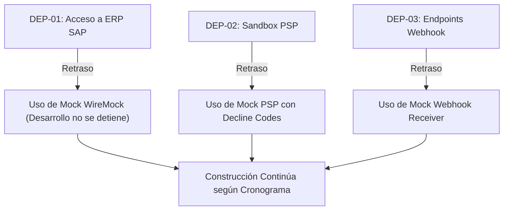

## Sources

- [desc] Initial description del proyecto Andes Retail.
- [bolt-plan.md] Plan de entregas por Bolts.
- [team-practices] Reglas de project.md sobre aprobación de producción.
- [DP-Q4] del delivery-planning-questions.md.

---

# Mapa de Dependencias Externas — Andes Retail PIE

Este documento identifica y cataloga todas las dependencias fuera del control directo del equipo de desarrollo de Vortexbird (servicios externos, credenciales de terceros, ventanas de disponibilidad y aprobaciones gerenciales), mapeándolas a los **Bolts** (un ciclo de construcción sobre una porción del trabajo que culmina en algo ejecutable y verificable) que las consumen.

---

## Tabla de Dependencias Externas

| ID | Dependencia Externa | Proveedor / Dueño | Impacto / Bolt Afectado | Tiempo Estimado de Respuesta | Estrategia de Mitigación / Contingencia |
|---|---|---|---|---|---|
| **DEP-01** | Acceso a API/Sandbox de SAP ERP AndesRetail | Equipo ERP AndesRetail | **Bolt 1** (`walking-skeleton`) | 3 a 5 días hábiles | Se utiliza un servidor mock de ERP en Docker/WireMock con latencia y fallos simulables para desacoplar el desarrollo. |
| **DEP-02** | Credenciales Sandbox de Pasarela de Pagos (PSP) | Proveedor PSP (e.g. Wompi/PayU) | **Bolt 4** (`payment-and-saga`) | 2 a 3 días hábiles | Implementación de un simulador de PSP que emite tokens y códigos de declinación realistas en entorno local/CI. |
| **DEP-03** | Definición de Endpoint Webhook del Canal Piloto | Equipo E-commerce AndesRetail | **Bolt 5** (`notification-webhooks`) | 5 días hábiles | Servicio de prueba HTTPS temporal (e.g. Webhook.site o pod receptor en EKS) para validar el despacho y firmas HMAC. |
| **DEP-04** | Aprobación de Arquitectura de Red y Certificados TLS | Oficial de Seguridad AndesRetail | **Bolt 1** y **Bolt 6** | 2 a 4 días hábiles | Uso de certificados internos gestionados por AWS Certificate Manager en entornos dev/staging mientras se emite el certificado público. |
| **DEP-05** | Aprobación Manual de Pase a Producción | Tech Lead + Product Owner AndesRetail | **Fase de Operación** (Post-Bolt 8) | 1 a 2 días hábiles | Hito de revisión formal pre-agendado con presentación de evidencias de pruebas de carga y escaneo de vulnerabilidades. |

---

## Matriz de Impacto en Caso de Retraso

---

## Assumptions & Open Questions

- [assumption] Todas las dependencias bloqueantes cuentan con simuladores y mocks para permitir que el 100% de la fase de Construcción y pruebas unitarias/integración se ejecuten de manera ininterrumpida.
- [assumption] Las credenciales reales de staging y producción serán aprovisionadas directamente en AWS Secrets Manager por el equipo de Andes Retail durante el Bolt 6.
