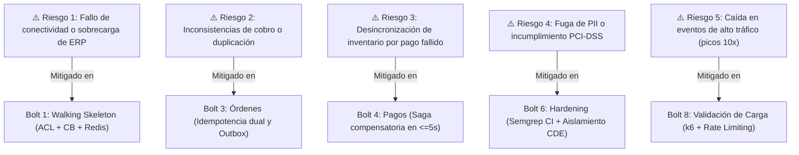

## Sources

- [desc] Initial description del proyecto Andes Retail.
- [team-practices] Prácticas afirmadas en team.md y project.md (Walking Skeleton, TDD).
- [U1] a [U8] del units.md de units-generation.
- [bolt-plan.md] Plan de entregas por Bolts.
- [DP-Q1] del delivery-planning-questions.md.

---

# Justificación de Riesgos y Secuenciamiento — Andes Retail PIE

Este documento detalla la justificación económica, técnica y de gestión de riesgos detrás del ordenamiento de la secuencia de **Bolts** (un ciclo de construcción sobre una porción del trabajo que culmina en algo ejecutable y verificable).

Para establecer este orden se utilizó una adaptación del modelo **WSJF** (*Weighted Shortest Job First*, un método de priorización que calcula el orden óptimo dividiendo el costo del retraso entre el tamaño del trabajo) combinado con la heurística de **Walking Skeleton First** (construir primero un corte delgado que demuestre la viabilidad de la arquitectura completa) propuesta por Alistair Cockburn.

---

## Modelo de Decisión y Racional Técnico

### 1. ¿Por qué el Walking Skeleton (Bolt 1) va Primero?
El mayor riesgo técnico en sistemas de interoperabilidad radica en la frontera de integración con sistemas heredados (*legacy systems*): latencia de red hacia el centro de datos on-premise, variabilidad de respuesta del ERP, mecanismos de autenticación y comportamiento del Circuit Breaker bajo estrés.

Construir primero el **walking skeleton** (un corte vertical delgado de punta a punta que recorre toda la arquitectura hasta funcionar de forma integrada):
- Demuestra que el cluster EKS, la VPC, Kong Ingress y Keycloak funcionan juntos de manera real.
- Valida que el patrón de Anti-Corruption Layer (ACL) y el Circuit Breaker con caché Redis protegen efectivamente al ERP.
- Despeja el camino para los siguientes Bolts: los desarrollos posteriores de órdenes y pagos se construyen sobre una plataforma ya probada y desplegada, en lugar de asumir hipótesis no verificadas.

### 2. Puntuación y Ranking WSJF Adaptado

| Bolt | Valor para el Negocio (BV) | Criticidad Temporal (TC) | Reducción de Riesgo / Habilitador (RR) | Costo del Retraso (CoD = BV+TC+RR) | Tamaño Relativo (Job Size) | Score WSJF (CoD / Size) | Orden de Ejecución |
|---|---|---|---|---|---|---|---|
| **Bolt 1: Walking Skeleton** | 8 | 9 | 10 | 27 | 5 | **5.4** | **1º** |
| **Bolt 2: Catálogo y Precios** | 7 | 6 | 5 | 18 | 3 | **6.0\*** | **2º** |
| **Bolt 3: Órdenes Core** | 10 | 9 | 7 | 26 | 5 | **5.2** | **3º** |
| **Bolt 4: Pagos y Saga** | 9 | 8 | 8 | 25 | 4 | **6.25\*** | **4º** |
| **Bolt 5: Webhooks Salientes**| 7 | 6 | 4 | 17 | 3 | **5.67** | **5º** |
| **Bolt 6: Hardening Seguridad**| 8 | 7 | 8 | 23 | 4 | **5.75** | **6º** |
| **Bolt 7: Observabilidad** | 6 | 5 | 6 | 17 | 3 | **5.67** | **7º** |
| **Bolt 8: Validación de Carga** | 9 | 9 | 9 | 27 | 4 | **6.75\*** | **8º** |

*\*Nota de ajuste topológico:* Aunque algunos Bolts posteriores (como Bolt 4 o Bolt 8) arrojan un score numérico WSJF alto, su ejecución respeta estrictamente el grafo de dependencias de `units-generation` (no es posible validar la Saga de pagos sin el Order Service, ni ejecutar la validación de carga sin los servicios desplegados).

---

## Análisis de Riesgos Mitigados por Secuencia

---

## Assumptions & Open Questions

- [assumption] La secuencia de Bolts respeta al 100% el orden topológico del Unit DAG generado en el stage 2.7.
- [assumption] Ante cualquier hallazgo crítico durante la demostración del Bolt 1 (Walking Skeleton), la arquitectura se revisará antes de iniciar la construcción del Bolt 3.
