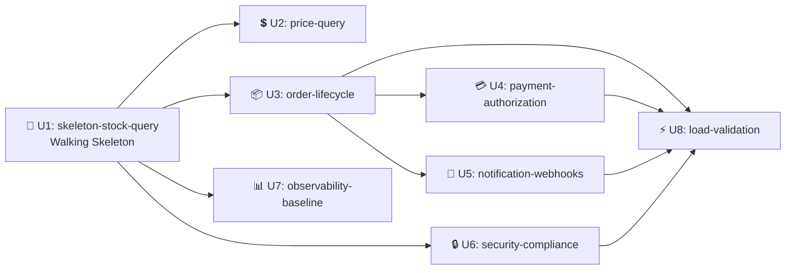

## Sources

- [desc] Initial description del proyecto.
- [scope] Scope document y intent backlog.
- [FR-01] a [FR-12], [NFR-01] a [NFR-14] del requirements.md.
- [CA-01] PCI-DSS — CDE, tokenización, enmascaramiento PII.
- [CA-02] Backpressure en adaptadores legacy.
- [CA-03] Clean Architecture — domain/application/infrastructure.
- [BC-ORDER] a [BC-NOTIFICATION] del domain-design components.md.
- [ADR-01] a [ADR-06] del domain-design decisions.md.
- [US-01] a [US-10] del user-stories stories.md.
- [memory:M1] Prácticas TDD afirmadas en practices-discovery.
- [TF-stack] Kotlin + Spring Boot / Python CDK.

---

## Unit DAG — Andes Retail Interoperability Platform

Las unidades se ejecutan en orden `unit-major` serial. La primera unidad es el
**walking skeleton** per las prácticas afirmadas en `team.md`: el slice
`GET /v1/inventory/stock/{sku}` end-to-end con autenticación JWT real, Circuit
Breaker y Cache Redis debe estar verde antes de construir el Order Service.

```yaml
units:
  # ────────────────────────────────────────────────────────────────────
  # UNIT 1 — Walking Skeleton (se ejecuta primero, antes que todo)
  # ────────────────────────────────────────────────────────────────────
  - name: skeleton-stock-query
    kind: service
    depends_on: []
    description: >
      Walking skeleton: infraestructura base (VPC, EKS, RDS Aurora, Redis,
      EventBridge, Secrets Manager, Kong, Keycloak) + Stock Adapter con
      GET /v1/inventory/stock/{sku} funcionando end-to-end desde canal
      externo autenticado hasta el ERP (via ACL con Circuit Breaker,
      Bulkhead y Cache Redis) y de regreso. Incluye autenticación JWT real
      con Keycloak, rate limiting en Kong, y log sanitization básico.
    requirements:
      - FR-01   # Consultar stock por SKU
      - FR-11   # Auth OAuth2/OIDC multi-tenant (base)
      - NFR-01  # Latencia p95 ≤ 300ms stock
      - NFR-04  # Disponibilidad 99.9%
      - NFR-06  # Cifrado TLS 1.3 + KMS
      - NFR-10  # Circuit Breaker en adaptadores legacy
      - NFR-11  # Rate limiting por canal
      - NFR-12  # Backpressure: Bulkhead ERP
      - CA-01   # PCI-DSS base
      - CA-02   # Backpressure
      - CA-03   # Clean Architecture
    stories:
      - US-01   # Consultar stock disponible
      - US-08   # Auth multi-tenant (base)
    verification: >
      Una llamada autenticada desde un cliente externo obtiene el stock de un
      SKU real con latencia p95 < 300ms, y el Circuit Breaker se activa
      correctamente cuando el ERP está simulado como offline.

  # ────────────────────────────────────────────────────────────────────
  # UNIT 2 — Consulta de Precios
  # ────────────────────────────────────────────────────────────────────
  - name: price-query
    kind: service
    depends_on: [skeleton-stock-query]
    description: >
      Extiende el Stock/Price Adapter con el endpoint de consulta de precios
      GET /v1/catalog/price/{sku}. Usa el mismo servicio, cache Redis y ACL
      que el Stock Adapter (CATALOG CONTEXT compartido en MVP). Incluye
      precios promocionales y segmentación por canal/cliente.
    requirements:
      - FR-02   # Consultar precio por SKU/canal/cliente
      - NFR-01  # Latencia p95 ≤ 300ms precio
    stories:
      - US-02   # Consultar precio por SKU y canal
    verification: >
      GET /v1/catalog/price/{sku}?channelId=X&customerSegment=Y retorna
      precio correcto (incluyendo promocional si aplica) en ≤ 300ms p95
      con JWT autenticado.

  # ────────────────────────────────────────────────────────────────────
  # UNIT 3 — Order Service (ciclo de vida completo)
  # ────────────────────────────────────────────────────────────────────
  - name: order-lifecycle
    kind: service
    depends_on: [skeleton-stock-query]
    description: >
      Order Service con Clean Architecture: crear orden (POST /v1/orders),
      idempotencia dual (Redis + Aurora, ADR-05), consultar estado
      (GET /v1/orders/{id}), Saga de compensación (liberar stock si pago
      falla, FR-06), Outbox Pattern para publicación confiable de eventos
      en EventBridge (ADR-02). Money en centavos (ADR-01). Aislamiento
      multi-tenant en consultas. Log sanitization para PII (Address,
      PaymentToken con toString() redactado, ADR-06).
    requirements:
      - FR-03   # Crear orden
      - FR-04   # Idempotencia en crear orden
      - FR-05   # Consultar estado de orden
      - FR-06   # Compensación Saga: liberar stock si pago falla
      - NFR-02  # Latencia end-to-end ≤ 2s crear orden
      - NFR-05  # Enmascaramiento PII en logs
      - NFR-08  # Auditoría con correlation-id
      - NFR-14  # Cobertura tests ≥ 80%
      - CA-01   # PCI-DSS — PaymentToken opaco
      - CA-03   # Clean Architecture
    stories:
      - US-03   # Crear orden end-to-end
      - US-04   # Idempotencia en crear orden
      - US-05   # Consultar estado de orden
    verification: >
      POST /v1/orders crea una orden, reserva stock via StockPort, autoriza
      pago via PaymentPort, publica order.confirmed en EventBridge, y
      retorna 201 en ≤ 2s. Un segundo POST con mismo Idempotency-Key
      retorna la respuesta original. Pago rechazado libera la reserva de
      stock en ≤ 5s.

  # ────────────────────────────────────────────────────────────────────
  # UNIT 4 — Payment Service
  # ────────────────────────────────────────────────────────────────────
  - name: payment-authorization
    kind: service
    depends_on: [order-lifecycle]
    description: >
      Payment Service: autorización de pago con token opaco del PSP (nunca
      PAN, CA-01). Implementa el puerto PaymentPort que el Order Service
      consume. Publica eventos payment.approved / payment.rejected en
      EventBridge. PaymentToken como Value Object opaco con toString()
      redactado (ADR-06).
    requirements:
      - CA-01   # PCI-DSS — nunca PAN
      - CA-03   # Clean Architecture
      - NFR-05  # PII en logs
      - NFR-14  # Cobertura tests ≥ 80%
    stories:
      - US-03   # Crear orden (parte de pago)
      - US-07   # Webhook resultado de pago (publicación)
    verification: >
      PaymentPort.authorize() con token válido retorna Authorized con
      chargeId. Token inválido retorna Declined. El token nunca aparece
      en logs. Evento payment.approved/rejected publicado en EventBridge.

  # ────────────────────────────────────────────────────────────────────
  # UNIT 5 — Notification Service (Webhooks)
  # ────────────────────────────────────────────────────────────────────
  - name: notification-webhooks
    kind: service
    depends_on: [order-lifecycle]
    description: >
      Notification Service: consume eventos de EventBridge (order.confirmed,
      payment.approved, payment.rejected) y los entrega como webhooks HTTP
      POST al endpoint registrado de cada canal. Firma HMAC-SHA256 del
      payload. Reintentos con backoff exponencial (30s, 60s, 120s). DLQ en
      SQS con alarma CloudWatch. Payload sin PII (CA-01).
    requirements:
      - FR-07   # Webhook orden confirmada
      - FR-08   # Webhook pago aprobado/rechazado
      - FR-10   # Reintentos con DLQ
      - CA-01   # PII en payload
      - NFR-14  # Cobertura tests ≥ 80%
    stories:
      - US-06   # Recibir webhook orden confirmada
      - US-07   # Recibir webhook resultado pago
    verification: >
      Evento order.confirmed en EventBridge dispara POST al endpoint del
      canal en ≤ 5s con firma HMAC válida. Endpoint no disponible →
      3 reintentos → DLQ → alarma CloudWatch en < 2min.

  # ────────────────────────────────────────────────────────────────────
  # UNIT 6 — Security & Compliance Hardening
  # ────────────────────────────────────────────────────────────────────
  - name: security-compliance
    kind: spec
    depends_on: [skeleton-stock-query]
    description: >
      Hardening transversal de seguridad y cumplimiento: middleware de log
      sanitization para PII en todos los servicios (Semgrep en CI),
      autorización por scopes y por canal con verificación completa,
      rotación automática de secretos (DB 30d, ERP 90d, Keycloak 60d),
      onboarding de canal externo sin cambios de código (Keycloak + Kong),
      cifrado KMS en todos los recursos de datos. Verificación de
      Dependency Rule con ArchUnit.
    requirements:
      - FR-11   # Auth OAuth2/OIDC completa
      - FR-12   # Onboarding de canal
      - NFR-05  # Enmascaramiento PII
      - NFR-06  # Cifrado TLS 1.3 + KMS
      - NFR-07  # Autorización por scopes/tenant
      - NFR-09  # Rotación de secretos
      - NFR-13  # Nuevos canales sin cambio de código
      - CA-01   # PCI-DSS
    stories:
      - US-08   # Auth multi-tenant (completa)
      - US-09   # Onboarding de canal
      - US-10   # Enmascaramiento PII en logs
    verification: >
      Scan de PII en CI detecta patrones y bloquea el build. Token de
      canal A no accede datos de canal B (403). Onboarding de segundo canal
      completo en < 4h sin deploy de código. Secretos con rotación
      automática verificada.

  # ────────────────────────────────────────────────────────────────────
  # UNIT 7 — Observability Baseline
  # ────────────────────────────────────────────────────────────────────
  - name: observability-baseline
    kind: packaging
    depends_on: [skeleton-stock-query]
    description: >
      Plataforma de observabilidad MVP: logs estructurados JSON con
      correlation-id en todos los servicios, Prometheus + Grafana con
      dashboards de las 10 métricas clave, CloudWatch Alarms para las
      6 alertas críticas (Circuit Breaker abierto, DLQ con mensajes,
      latencia p95, error rate, disponibilidad, rotación fallida).
    requirements:
      - NFR-04  # Disponibilidad 99.9% (monitoreo)
      - NFR-08  # Auditoría con correlation-id
    stories: []
    verification: >
      Dashboard de Grafana muestra las 10 métricas clave. CloudWatch Alarm
      se dispara cuando CB abre o DLQ recibe mensaje. Logs de un request
      tienen el mismo correlation-id en todos los servicios.

  # ────────────────────────────────────────────────────────────────────
  # UNIT 8 — Validación de Carga y SLAs
  # ────────────────────────────────────────────────────────────────────
  - name: load-validation
    kind: spec
    depends_on:
      - order-lifecycle
      - payment-authorization
      - notification-webhooks
      - security-compliance
    description: >
      Suite de validación de carga y SLAs: tests k6 para stock (≤300ms
      p95), orden (≤2s p95), picos 10x (rate limiting activo, CB absorbe
      exceso, ERP no sobrecargado). Verificación de rate limiting por canal
      (429 correcto). Prueba end-to-end del flujo completo desde
      autenticación hasta webhook entregado.
    requirements:
      - NFR-01  # Latencia p95 stock
      - NFR-02  # Latencia e2e orden
      - NFR-03  # Picos 10x
      - NFR-04  # Disponibilidad 99.9%
      - NFR-11  # Rate limiting
    stories: []
    verification: >
      k6 a 100 req/s durante 5min: stock p95 ≤ 300ms, orden p95 ≤ 2s.
      k6 a 10x baseline: rate limiting activo, CB absorbe exceso,
      ERP no recibe > 20 llamadas concurrentes. Flujo e2e completo
      desde JWT hasta webhook entregado.
```

---

## Grafo de Dependencias

```
skeleton-stock-query (U1) ─ Walking Skeleton
├── price-query (U2)
├── order-lifecycle (U3)
│   ├── payment-authorization (U4)
│   └── notification-webhooks (U5)
├── security-compliance (U6)
└── observability-baseline (U7)

load-validation (U8) ← depende de U3, U4, U5, U6
```



---

## Orden de Ejecución (serial, unit-major)

| Orden | Unidad | Kind | Justificación |
|---|---|---|---|
| 1 | `skeleton-stock-query` | service | Walking skeleton — valida la arquitectura e2e antes de invertir en el resto |
| 2 | `price-query` | service | Extiende el servicio del skeleton (mismo adapter, mínimo riesgo) |
| 3 | `order-lifecycle` | service | Flujo de negocio principal, depende del Stock Adapter del skeleton |
| 4 | `payment-authorization` | service | Depende del Order Service para integrarse |
| 5 | `notification-webhooks` | service | Depende de los eventos del Order Service |
| 6 | `security-compliance` | spec | Hardening transversal sobre la infraestructura existente |
| 7 | `observability-baseline` | packaging | Dashboards y alertas sobre los servicios ya desplegados |
| 8 | `load-validation` | spec | Validación final de SLAs con todos los servicios operativos |

---

## Assumptions & Open Questions

- [assumption] La ejecución es `serial` + `unit-major`: cada unidad recorre todos los stages de construction (functional-design → nfr-requirements → nfr-design → infrastructure-design → code-generation → build-and-test → ci-pipeline) antes de pasar a la siguiente.
- [assumption] El walking skeleton (U1) incluye la infraestructura base (VPC, EKS, RDS, Redis) porque sin ella no se puede demostrar el slice end-to-end. Las unidades posteriores reutilizan esa infraestructura.
- [assumption] El Catalog Context (precios) comparte servicio con el Inventory Context en el MVP (U2 extiende el adapter de U1). Se puede separar en mes 3 si la carga lo justifica.
- [assumption] Las dependencias U3→U4 y U3→U5 no bloquean la construcción de U3: el Order Service usa puertos (interfaces) que se pueden mockear. La dependencia es para la integración completa.
